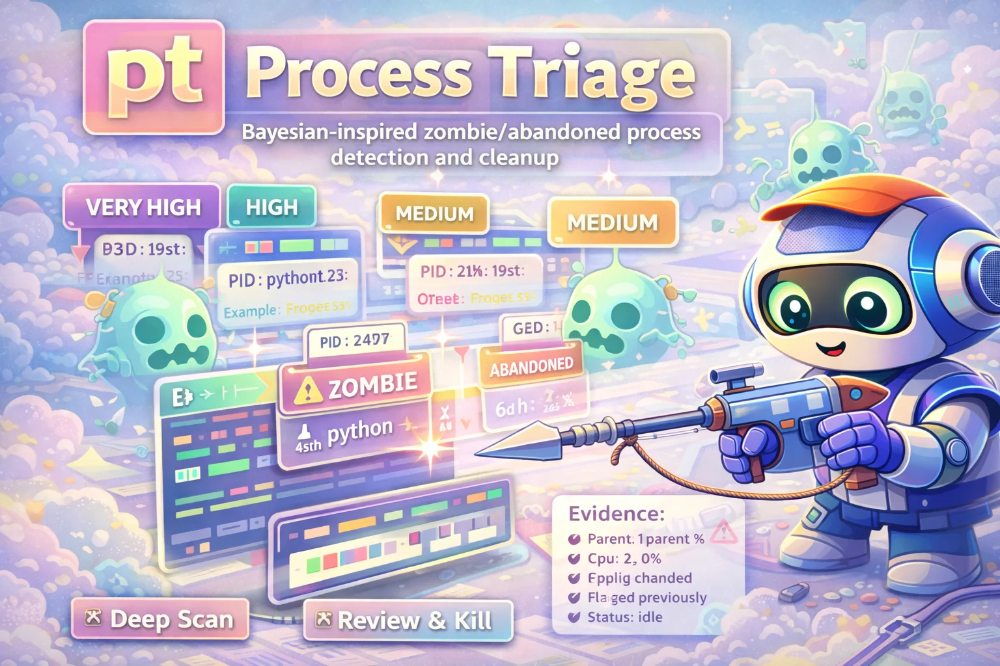

# pt

<div align="center">
  
</div>

<div align="center">

[](./LICENSE)

</div>

```bash
curl -fsSL https://raw.githubusercontent.com/Dicklesworthstone/process_triage/main/install.sh | bash
```

**`pt` finds abandoned processes and helps you get rid of them safely.** It scores every process with a Bayesian posterior (CPU, age, orphan status, terminal, state, plus process lineage and shared resources on Linux), refuses to touch live infrastructure (multiplexers, SSH masters, databases, agent sessions, your own shell), and tells you *why* each candidate looks abandoned. It is deliberately conservative: most candidates come back as `review` or `pause`, and a `kill` recommendation needs overwhelming evidence.

---

## The Problem

Development machines accumulate abandoned processes. Stuck `bun test` workers. Forgotten `next dev` servers from last week's branch. Orphaned Claude/Copilot sessions. Build processes that completed but never exited. They silently eat RAM, CPU, and file descriptors until your 64-core workstation grinds to a halt.

Manually hunting them with `ps aux | grep` is tedious, error-prone, and teaches you nothing about whether killing something will break something else.

## The Solution

`pt` automates detection with statistical inference, skips protected processes before scoring, and presents ranked candidates with the evidence behind each score (`pt` opens the TUI; `pt agent plan` gives the same ranking as JSON):

```text
 SCORE  ACTION  PID     AGE    CPU   MEM     COMMAND
   85   pause   412233  260h   0.0%  12MB    python3 -m http.server 61493 --bind 127.0.0.1   (orphan)
   83   review  90121   211h   0.2%  134MB   chrome --headless ...                            (orphan)
   46   review  48758   1h     0.0%  1MB     sleep 8888                                       (orphan)
        spare   1204            protected: builtin.service_daemon (postgres)
```

The score is 100 × P(abandoned or zombie). The action is the one with the lowest expected loss under the policy's loss matrix, which makes `kill` rare by design (see [the 8 actions](#the-8-actions)).

## Why pt?

| Feature | `ps aux \| grep` | `htop` | `pt` |
|---------|:-:|:-:|:-:|
| Finds abandoned processes automatically | - | - | Yes |
| Bayesian confidence scoring | - | - | Yes |
| Explains *why* a process is suspicious | - | - | Yes |
| Estimates blast radius before kill (Linux) | - | - | Yes |
| Learns from your past decisions | - | - | Yes |
| Built-in protection for live infrastructure | - | - | Yes |
| Fleet-wide planning over SSH | - | - | Yes |
| Guardrails for automation (posterior, RSS, kill caps, live pre-checks) | - | - | Yes |
| Safe kill signals (SIGTERM → SIGKILL) | - | - | Yes |
| Interactive TUI | - | Yes | Yes |

---

## Quick Example

```bash
# Install (one-liner)
curl -fsSL https://raw.githubusercontent.com/Dicklesworthstone/process_triage/main/install.sh | bash

# Interactive mode — scan, review, confirm, kill
pt

# Scored candidates without acting (JSON; what agents and scripts use)
pt agent plan --format json

# Raw process snapshot / raw deep /proc records (no scoring)
pt scan
pt deep

# Compare two sessions to see what changed
pt diff --last

# Shadow mode — record recommendations without acting (calibration)
pt shadow start
```

---

## Design Philosophy

**1. Conservative by default.** No process is ever killed without explicit confirmation. Robot mode is off unless enabled in policy, needs `--yes`, a posterior of at least `min_posterior` (0.95) for the event that justifies the action, per-action and total RSS limits, a kill cap, and live pre-checks (identity, protection, session safety, data-loss gate) immediately before acting.

**2. Transparent decisions.** Every recommendation comes with its evidence: which features contributed, how much each shifted the posterior, and the expected loss of every action (`pt agent explain --galaxy-brain`, the TUI detail pane, `pt report --include-ledger`).

**3. Protection before scoring.** Terminal multiplexers, SSH ControlMasters, session infrastructure, interactive shells, database/web servers and their workers, pt's own caller chain, systemd/container-supervised services, and on macOS system and app-bundle processes are never candidates. AI agent CLIs are only ever shown for review.

**4. Real processes in tests.** Parsers, collectors and the action layer are tested against real /proc and real spawned processes; a live read-only fleet gate (`scripts/fleet_reality_e2e.py`) checks plans on real hosts. Some higher-level tests use synthetic process builders.

---

## How It Actually Works

### The Inference Pipeline

Every process on your system passes through a five-stage pipeline:

```
          ┌─────────┐     ┌─────────┐     ┌─────────┐     ┌─────────┐     ┌─────────┐
 /proc ──→│ Collect │────→│  Infer  │────→│ Decide  │────→│   Act   │────→│ Report  │
          └─────────┘     └─────────┘     └─────────┘     └─────────┘     └─────────┘
           25 modules      41 modules      40 modules      13 modules      5 formats
```

**Collect** takes a process snapshot (`ps` plus exact start times from `/proc` or `proc_pidinfo`), cgroup placement, and on Linux process lineage and a shared-resource graph (listeners, sockets, lockfiles).

**Infer** computes a 4-class posterior (useful, useful-but-bad, abandoned, zombie) by naive Bayes over CPU occupancy, age, orphan status, controlling terminal and kernel state, with each term clipped and tempered so no single signal dominates. On Linux, lineage and shared-resource evidence add terms; signature matches and your own past verdicts (`pt agent label`, TUI kills) set the prior. The TUI also uses deep network/I/O evidence when it collects it.

**Decide** picks the action with the lowest expected loss under the policy's loss matrix, among the actions feasible for the process state, then applies protection, supervision and policy enforcement. Rather than a binary kill/spare, it evaluates Keep, Renice, Pause, Freeze, Throttle, Quarantine, Restart and Kill.

**Act** re-verifies identity (exact start time; a pidfd on Linux) and runs live pre-checks immediately before each signal, then escalates SIGTERM → SIGKILL. Renice, pause/resume and kill run on Linux and macOS; freeze, throttle and quarantine are Linux-only and refused unless the target owns its cgroup. Failures are reported; there is no automatic rollback.

**Report** produces JSON, TOON (token-optimized), Markdown, HTML reports, or the interactive TUI, with the evidence ledger and Bayes factors.

### Experimental Library Models

The workspace also ships these models as tested library code. **None of them is wired into `agent plan`, the TUI, or `agent apply` yet**; they are candidates to be added only where they measurably improve decisions:

| Model | What It Detects | How It Works |
|-------|----------------|--------------|
| **BOCPD** | Sudden behavior changes | Bayesian Online Change-Point Detection with run-length recursion |
| **HSMM** | State transitions with duration | Hidden Semi-Markov Model with Gamma-distributed dwell times |
| **IMM** | Regime switching | Interacting Multiple Model filter bank with Markov transitions |
| **Kalman** | Trend estimation | Scalar Kalman filter + Rauch-Tung-Striebel backward smoother |
| **CTW** | Sequential prediction | Context Tree Weighting with Krichevsky-Trofimov estimator |
| **Hawkes** | Burst detection | Self-exciting point process (branching ratio n=alpha/beta) |
| **EVT/GPD** | Tail risk | Extreme Value Theory with Generalized Pareto Distribution |
| **Conformal** | Distribution-free coverage | Mondrian split conformal with blocked + adaptive variants |
| **Martingale** | Anytime-valid testing | Azuma-Hoeffding + Freedman/Bernstein bounds |
| **Wasserstein** | Distribution drift | 1D earth-mover's distance for non-stationarity detection |
| **M/M/1 Queue** | Socket stall detection | EWMA-smoothed queue depth with logistic rho estimation |
| **Compound Poisson** | Bursty I/O | Markov-modulated Levy subordinator |
| **Belief Prop** | Hierarchical inference | Message-passing over process lineage trees |
| **Robust Bayes** | Model misspecification | Credal sets + Safe-Bayes eta-tempering |
| **BMA** | Model uncertainty | Bayesian Model Averaging across competing posteriors |
| **Sketches** | Heavy hitters | Count-Min Sketch + T-Digest + Space-Saving for pattern detection |

All computation happens in log-domain using numerically stable log-sum-exp to prevent overflow/underflow.

### The 8 Actions

Most tools only know "kill" or "don't kill." `pt` evaluates 8 possible actions ranked by expected loss:

| Action | Signal/Mechanism | Reversible | Executes on |
|--------|-----------------|:--:|-----------|
| **Keep** | No action | Yes | - |
| **Renice** | lower priority (`nice`), never raises it | Yes | Linux, macOS |
| **Pause** | `SIGSTOP` (resume: `SIGCONT`) | Yes | Linux, macOS |
| **Freeze** | cgroup v2 freezer | Yes | Linux, if the target owns its cgroup |
| **Throttle** | cgroup CPU quota | Durable session receipt on v2 | Linux, in an exclusive leaf |
| **Quarantine** | cpuset controller | Explicit prior metadata | Linux, in an exclusive leaf |
| **Restart** | via the supervisor | Partial | not executable yet (planned, e.g. for a zombie's parent); apply reports it as failed |
| **Kill** | SIGTERM → SIGKILL | No | Linux, macOS |

**Why `kill` is rare.** The default loss matrix makes killing a useful process 500 times worse than leaving an abandoned one paused, so `kill` wins only when P(useful) is below about 0.7% of P(abandoned). The posterior is deliberately conservative, so on real machines idle orphans usually come back as `pause` or `review`. Your own verdicts (`pt agent label --kill`) raise the prior for a command pattern; the loss matrix is configurable in `policy.json`.

### Evidence Collection: What /proc Files Are Parsed

On Linux, `pt deep` reads 12+ files per process (raw records; the TUI turns network/I/O activity into evidence terms, `agent plan` does not yet use them):

| File | Data Extracted |
|------|---------------|
| `/proc/[pid]/stat` | PID, PPID, state, utime, stime, starttime, vsize, rss, num_threads |
| `/proc/[pid]/io` | rchar, wchar, syscr, syscw, read_bytes, write_bytes |
| `/proc/[pid]/fd/` | Open file descriptors with type (socket, pipe, file, device) |
| `/proc/[pid]/schedstat` | CPU time, wait time, timeslices |
| `/proc/[pid]/sched` | Voluntary/involuntary context switches, priority |
| `/proc/[pid]/statm` | Memory pages (size, resident, shared, text, data) |
| `/proc/[pid]/cgroup` | cgroup v1/v2 paths, CPU/memory limits |
| `/proc/[pid]/wchan` | Kernel wait channel (detects D-state processes) |
| `/proc/[pid]/environ` | Environment variables (for workspace/supervisor detection) |
| `/proc/net/tcp` | TCP connections with tx_queue/rx_queue depths |
| `/proc/net/udp` | UDP socket state |
| `/proc/net/unix` | Unix domain sockets with reference counts |

Critical file detection recognizes 20+ patterns: git locks (`.git/index.lock`), package manager locks (dpkg, apt, rpm, npm, pnpm, yarn, cargo), SQLite WAL/journal files, database write handles, and generic `.lock`/`.lck` files. At apply time the data-loss gate blocks any target holding a regular file open for writing or a file lock; the categorized critical-file rules are not yet attached to plans.

### The TUI

The interactive TUI is built on **ftui** (an Elm-style Model-View-Update framework for terminals):

- **Responsive layout**: adapts to terminal width with breakpoints at 80/120/200 columns (single-panel, two-pane, three-pane)
- **Process table**: sortable by score, age, CPU, memory, with live filtering via search input
- **Detail panel**: expanded evidence view for the selected process including Bayes factors, evidence term glyphs, and decision rationale
- **Command palette**: fuzzy-searchable action palette for power users
- **Inline mode** (`pt run --inline`): confines the UI to a bottom region, preserving terminal scrollback above

From source: `cargo run -p pt-core -- run` (the `ui` feature is on by default).

### Session Diffing

`pt diff --last` compares two scan snapshots and classifies every process into lifecycle transitions:

| Transition | Meaning |
|------------|---------|
| `Appeared` | New process since last scan |
| `Resolved` | Process exited since last scan |
| `Stable` | Same classification and score |
| `NewlyOrphaned` | Parent died, process adopted by init |
| `Reparented` | Process moved to a new parent |
| `StateChanged` | Classification changed (e.g., Useful → Abandoned) |
| `OwnershipChanged` | User or group changed |

Each delta includes `score_drift` (how much the score changed), `worsened`/`improved` flags, and continuity confidence.

### MCP Server

`pt` includes a Model Context Protocol server for AI agent integration:

```bash
pt-core mcp   # Start JSON-RPC 2.0 server over stdio
```

Available tools:

- `pt_plan`: the same engine, protections and output as `pt agent plan --format json`.
- `pt_scan`: a process listing with signature-match scores.
- `pt_explain`: a PID's evidence.
- `pt_history`: recent sessions.
- `pt_signatures`
- `pt_capabilities`

AI agents can use these to query process state, run scans, and make triage decisions without CLI parsing.

### Learning Tutorials

```bash
pt learn list              # Show available tutorials
pt learn show 01           # Read a tutorial
pt learn verify --all      # Verify completion
```

Built-in tutorials cover first-run safety, stuck test runners, port conflicts, agent workflow, fleet operations, shadow mode, and deep scanning. `pt learn verify` smoke-runs each tutorial's commands under a time budget to check they still work.

---

## Installation

### Quick Install (recommended)

```bash
curl -fsSL https://raw.githubusercontent.com/Dicklesworthstone/process_triage/main/install.sh | bash
```

Installs `pt` (bash wrapper) and `pt-core` (Rust engine) to `~/.local/bin/`.

### Package Managers

There is no Homebrew formula, Scoop manifest, or winget package for `pt` yet.
Use the install script above (it works on macOS and Linux, and inside WSL2 on
Windows), or build from source below.

### From Source

```bash
git clone https://github.com/Dicklesworthstone/process_triage.git
cd process_triage
cargo build --release -p pt-core
ln -s "$(pwd)/pt" ~/.local/bin/pt
```

### Verified Install

```bash
# Verify ECDSA signatures + checksums (fail-closed on missing/invalid metadata).
# Pass --verify to bash (a `VERIFY=1 curl ... | bash` prefix only reaches curl).
curl -fsSL https://raw.githubusercontent.com/Dicklesworthstone/process_triage/main/install.sh | bash -s -- --verify
```

Releases up to v2.1.0 were published without signatures, so a verified install of them fails closed ("does not publish release-signing-public.pem") and installs nothing. `pt update` verifies by default and says so when it refuses; `pt update --no-verify` installs unverified on explicit request.

The installer and the `pt` wrapper pin the release-signing key: a verified install or `pt update` accepts a release only if its `release-signing-public.pem` has one of the SHA-256 fingerprints (of the DER public key) listed in `TRUSTED_RELEASE_KEY_FINGERPRINTS`, currently `b5084da80f9652304307fa7c3f965ee7840d3815fd863c2b40f4524e00e2e4ee` (first used for v2.2.0). A release signed with any other key is refused even if its signatures are internally consistent. `PT_RELEASE_PUBLIC_KEY_FINGERPRINT` (comma- or space-separated) or `PT_RELEASE_PUBLIC_KEY_FINGERPRINT_FILE` replaces the built-in list, for example to pin a fork's own key.

**Platforms:** Linux x86_64 (primary), Linux aarch64, macOS x86_64, macOS aarch64, Windows x86_64 (via WSL2 only, using the Linux install)

---

## Quick Start

### 1. Interactive Mode (recommended)

```bash
pt
```

Runs the full triage workflow: **Scan** → **Review** → **Confirm** → **Kill**.

Use `pt run --inline` to preserve terminal scrollback.

### 2. Scored Candidates Without Acting

```bash
pt agent plan --format json                 # ranked candidates, evidence, recommended actions
pt agent explain --session <id> --pids 1234 # why one process scored the way it did
```

`pt scan` and `pt deep` print raw process snapshots (JSON by default), not scores.

### 3. Agent/Robot Mode

```bash
pt agent plan --format json            # Structured JSON plan
pt agent plan --format toon            # Token-optimized output
pt agent plan --pids 1234,5678          # Score selected PIDs with full ancestry/protection checks
pt agent apply --session <id> --yes    # Execute a plan (needs robot_mode.enabled=true in policy)
pt agent verify --session <id>         # Confirm outcomes
pt agent label --pid 1234 --kill       # Teach pt your verdict for this command pattern
pt agent watch --format jsonl          # Stream events
```

### 4. Shadow Mode (calibration)

```bash
pt shadow start                   # Observe without acting
pt shadow report -f md            # ASCII calibration report
pt shadow stop                    # Stop observer
```

---

## Command Reference

| Command | Description | Example |
|---------|-------------|---------|
| `pt` | Interactive triage (scan + review + kill) | `pt` |
| `pt run --inline` | Interactive with preserved scrollback | `pt run --inline` |
| `pt scan` | Raw process snapshot (no scoring) | `pt scan` |
| `pt deep` | Raw deep /proc records (Linux) | `pt deep` |
| `pt agent plan` | Scored, ranked candidates + plan | `pt agent plan --format json` |
| `pt agent explain` | Evidence for specific PIDs | `pt agent explain --session <id> --pids 1234` |
| `pt agent label` | Record your kill/spare verdict | `pt agent label --pid 1234 --spare` |
| `pt agent apply` | Execute a plan (robot mode) | `pt agent apply --session <id> --yes` |
| `pt agent undo` | Inspect or restore a recorded cgroup control | `pt agent undo --session <id> --action-id <action-id>` |
| `pt agent verify` | Confirm outcomes | `pt agent verify --session <id>` |
| `pt agent watch` | Stream events | `pt agent watch --format jsonl` |
| `pt agent report` | Generate HTML report | `pt agent report --session <id>` |
| `pt diff` | Compare two sessions | `pt diff --last` |
| `pt learn` | Interactive tutorials | `pt learn list` |
| `pt bundle create` | Export session bundle | `pt bundle create --session <id> --output out.ptb` |
| `pt report` | HTML report from session | `pt report --session <id> --output report.html` |
| `pt shadow start` | Start calibration observer | `pt shadow start` |
| `pt doctor` | Read-only host hygiene audit (prints fixes, never runs them) | `pt doctor --format md` |
| `pt config validate` | Validate config files | `pt-core config validate policy.json` |
| `pt --version` | Show version | `pt --version` |
| `pt --help` | Full help | `pt --help` |

---

## Core Concepts

### Four-State Classification

Every process is classified into one of four states via Bayesian posterior updates:

| State | Description | Typical Action |
|-------|-------------|----------------|
| **Useful** | Actively doing productive work | Leave alone |
| **Useful-Bad** | Running but stalled, leaking, or deadlocked | Throttle, review |
| **Abandoned** | Was useful, now forgotten | Kill (usually recoverable) |
| **Zombie** | Terminated but not reaped by parent | Clean up |

### Evidence Sources

| Evidence | What It Measures | Impact | Used by |
|----------|------------------|--------|---------|
| CPU activity | Active computation vs idle | Idle + old = suspicious | all |
| Runtime | Age of the process | Old = more suspicious | all |
| Orphan | Reparented to init and lost its session | Orphans are suspicious | all |
| TTY state | Controlling terminal or detached? | Detached old processes = suspicious | all |
| Kernel state | Running, sleeping, zombie, D-state | Zombie = terminal | all |
| Lineage / shared resources | Ownership, listeners, lockfiles, blast radius | Shifts toward useful when others depend on it | `agent plan` (Linux) |
| I/O and network activity | Recent file/network I/O | No I/O for hours = abandoned | TUI deep evidence |
| Network queues | Socket rx/tx queue depth | Deep queues = stalled (useful-bad) | TUI deep evidence |
| Signatures | Test runner, dev server, build tool? | Sets the prior | all |
| Past decisions | Have you killed or spared similar processes? | Sets the prior per pattern | all |

### Confidence Levels

`confidence` in plans labels how peaked the posterior is:

| Level | Posterior | Meaning |
|-------|-----------|------------|
| `very_high` | > 0.99 | Strong evidence |
| `high` | > 0.95 | Clears the default robot `min_posterior` |
| `medium` | > 0.80 | Requires confirmation |
| `low` | < 0.80 | Review only |

Robot eligibility is decided by `robot_mode.min_posterior` against the probability that justifies the action (P(abandoned or zombie) for kill), not by this label.

---

## Safety Model

### Identity Validation

Every kill target is verified by a triple `<boot_id>:<start_time_ticks>:<pid>` that prevents PID-reuse attacks, stale plan execution, and race conditions.

### Protected Processes

Protection has two layers:

- **Policy** (`policy.json` → `guardrails`): protected patterns (defaults `systemd`, `sshd`), protected users (default `root`), protected categories (`database`, `webserver`), PIDs, and children of PID 1.
- **Built-in** (`guardrails.builtin_protection`, on by default):
  - terminal multiplexers (tmux, zellij, screen, wezterm/frankenterm mux servers), SSH ControlMasters (e.g. rch's shared connections), session infrastructure (sshd sessions, `systemd --user`, dbus, pipewire, agents), the display-manager / session-manager process that holds a graphical login (`sddm-helper`, `gdm-session-worker`, `lightdm --session-child`, `greetd`, `uwsm start`, `gnome-session-binary`, `ksmserver`, …), interactive shells, and what is on someone's screen: terminal emulators, display servers/compositors (including kiosk `cage`) and live monitors such as `htop`/`btop` (headless `Xvfb` stays a candidate);
  - `pt` itself and every process that invoked it;
  - database / web / message servers by name, even under rewritten titles (`postgres: … io worker`, `nginx: worker process`; also mysqld/mariadbd, redis/valkey, mongod, memcached, httpd/apache2, caddy, haproxy, traefik, php-fpm, clickhouse, etcd, rabbitmq, mattermost, minio, elasticsearch), **and every descendant of one** (workers, plugins), wherever they run: systemd, docker or a plain shell. `pt agent plan` reports the per-rule counts in `summary.protected_by_rule`;
  - on Linux, anything supervised by systemd (`system.slice/*.service`, user units) or a container runtime, which covers postgres/nginx/mysql workers, docker containers and the like;
  - AI agent CLIs (claude, codex, gemini/agy, …) are never pre-selected or robot-killed; they are shown for manual review.
- On macOS (no cgroups), placement comes from owner and executable: `root` and system role accounts (`_windowserver`, …), Apple platform binaries (`/System`, `/usr/libexec`, `/usr/sbin`, `/sbin`, `/Library/Apple`) and anything inside a `.app` bundle (GUI apps and their helpers) are protected (`builtin.macos_system`). A real user's other processes are evaluated even after being reparented to launchd (PID 1), which is how a dev server orphaned by a closed terminal looks there.
- On Linux, a workload started inside a login session (for example a build running as root over SSH on a build worker, or an orphan reparented to PID 1) is **not** covered by the root-user / PID-1 rules, because it is a candidate rather than a system service.
- Where placement is unknown (Linux without systemd cgroups: cgroup v1 hosts, a container's own root namespace), the root-user and PID-1 rules apply unchanged: root's processes and children of PID 1 stay protected there, so such hosts see fewer candidates. The scan filter and the policy enforcer behind `agent plan` use this one placement rule, so a process the scan evaluates is not downgraded to review afterwards because of where it runs (before, every macOS orphan was).

A terminal pane can inherit its multiplexer's user-service cgroup. On Linux, `pt` evaluates that pane's workloads like a transient scope when it can verify a same-owner ancestry chain with a controlling terminal below the live mux executable. Scan, plan and apply use this shared classification, so a pane workload is not given advice to restart the mux service. The mux itself, agent-mail and `rchd` servers, NTM session monitors and their service children stay protected. Missing or changed evidence retains service protection; a pane adopted by the user manager after losing its mux ancestry also retains protection.
- Desktop applications are evaluated, not protected, but scored as what they are: a process without a terminal in an XDG application unit of the user's systemd manager (`app-*.scope` / `app-*.service`, which is how GNOME, KDE and uwsm launch apps) gets desktop-app ownership evidence toward useful, and its missing TTY is not counted against it. An idle app left open for days is not a candidate; a runaway one still can be. Commands typed into a terminal emulator share its unit but have a TTY, so they are judged on their own evidence. A process in such a unit whose matched signature expects it to be left behind (a jest or pytest that an editor extension started, say) gets no desktop-app credit; plan and explain report this as `desktop_app_credited: false`.

### Staged Kill Signals

1. **SIGTERM** — graceful shutdown request
2. **Wait** — configurable timeout for cleanup
3. **SIGKILL** — forced termination if SIGTERM fails

### Provenance-Aware Blast Radius

On Linux, `pt agent plan` builds a **shared-resource graph** mapping which processes share lockfiles, sockets, listeners, and pidfiles, and estimates each candidate's direct impact (co-holders of shared resources, supervised processes, children). A high estimated blast radius lowers the abandonment posterior; it is evidence, not a hard block. Plans also report each candidate's RSS, CPU and number of direct children. Separately, a process-tree pass never recommends killing a process whose live children would not also be killed, and caps anything under a live agent session at `review`.

### Robot/Agent Safety Gates

All of these apply in `pt agent apply` (robot mode is off by default: `robot_mode.enabled`):

| Gate | Default | Purpose |
|------|---------|---------|
| `robot_mode.min_posterior` | 0.95 | P(abandoned or zombie) for kill/restart, 1 − P(useful) for other actions |
| `robot_mode.max_blast_radius_mb` | 4096 | Per-action RSS limit (`--max-total-blast-radius` for the run) |
| `robot_mode.max_kills` | 5 | Per-run kill limit |
| `robot_mode.require_human_for_supervised` | true | Processes under an agent/IDE/CI need a human (fails closed if unknown) |
| protection rules | on | Built-in + `guardrails.protected_*`, re-checked live before each action |
| live pre-checks | always | Identity, protection, session safety, data-loss gate, supervisor; a plan cannot opt out |

Fleet plans additionally pool kill decisions across hosts, keeping the posterior expected false-discovery proportion of the pooled kill set within `--max-fdr`; single-host plans report the expected false-discovery rate of their kill set.

---

## Architecture

```
pt (Bash wrapper)
 └─ pt-core (Rust binary, 8 crates, 100+ modules)
     ├─ Collect ─────── ps + exact /proc (Linux) / proc_pidinfo (macOS)
     │                  timing, cgroup placement, lineage, shared-resource
     │                  graph (Linux), deep /proc probes via io_uring
     │
     ├─ Infer ──────── 4-class naive-Bayes posterior (log-domain, clipped
     │                  and tempered terms), signature + learned priors,
     │                  provenance terms (Linux)
     │
     ├─ Decide ─────── Expected-loss minimization, protection and policy
     │                  enforcement, process-tree safety, Value of
     │                  Information (deep-scan hint), goal optimizer,
     │                  fleet expected-FDR pooling
     │
     ├─ Act ────────── identity-pinned signals (pidfd on Linux),
     │                  SIGTERM → SIGKILL, renice, pause/resume,
     │                  cgroup freeze/throttle/quarantine (Linux), live
     │                  pre-checks
     │
     └─ Report ─────── JSON/TOON/Markdown/HTML output, evidence ledger,
                        Galaxy-Brain cards, session bundles

 Library-only (tested, not wired into commands yet): BOCPD, HSMM, IMM,
 Kalman, CTW, Hawkes, EVT, conformal, martingales, CVaR, DRO, Gittins,
 causal snapshots, recovery trees, user-intent, workspace and GPU
 collectors, incremental scanning, OPE, contextual bandits.
```

### Workspace Structure

```
process_triage/
├── Cargo.toml              # Workspace root
├── pt                      # Bash wrapper
├── install.sh              # Installer + ECDSA verification
├── crates/
│   ├── pt-core/            # Main engine (41 inference + 40 decision + 25 collect modules)
│   ├── pt-common/          # Shared types, evidence schemas, provenance IDs
│   ├── pt-config/          # Configuration loading, priors, policy validation
│   ├── pt-math/            # Log-domain arithmetic, numerical stability
│   ├── pt-bundle/          # Session bundles (ZIP + ChaCha20-Poly1305 encryption)
│   ├── pt-redact/          # HMAC hashing, PII scrubbing, redaction profiles
│   ├── pt-telemetry/       # Arrow schemas, Parquet writer, LMAX disruptor
│   └── pt-report/          # HTML report templating (Askama + minify-html)
├── test/                   # BATS test suite
├── docs/                   # User + architecture documentation
│   └── math/PROOFS.md      # Formal mathematical guarantees
├── examples/configs/       # Scenario configurations
├── fuzz/                   # Fuzz testing targets
└── crates/pt-core/benches/ # Criterion benchmarks
```

---

## Configuration

### Directory Layout

```
~/.config/process_triage/
├── decisions.json      # Learned kill/spare verdicts per command pattern
├── signatures.json     # User signatures (`pt-core signature add/import`)
├── priors.json         # Bayesian hyperparameters (optional)
└── policy.json         # Safety policy (optional)

~/.local/share/process_triage/
└── sessions/
    └── pt-20260115-143022-a7xq/
        ├── manifest.json            # Session metadata and state
        ├── context.json             # Host / run context
        ├── scan/inventory.json      # Process identities and commands
        ├── inference/results.json   # Four-class posteriors
        ├── decision/plan.json       # Executable plan and recorded evidence
        ├── action/outcomes.jsonl    # Action outcomes
        └── logs/session.jsonl       # Session event log
```

The config directory is `$XDG_CONFIG_HOME/process_triage` (default `~/.config/process_triage`) on every platform; `--config` / `PT_CONFIG_DIR`, then `PROCESS_TRIAGE_CONFIG`, override it, and every file above (signatures included) follows the override. (Earlier releases kept `signatures.json`, `pattern_stats.json` and the `patterns/` files in `~/Library/Application Support/process_triage` on macOS; without an override pt still reads each one from there until the config directory has its own copy, and the next `signature` change or `agent fleet transfer import` saves the full contents to the config directory.) The data directory defaults to `~/.local/share/process_triage` on Linux and `~/Library/Application Support/process_triage` on macOS; `PROCESS_TRIAGE_DATA` or `XDG_DATA_HOME` override it.

Fleet configuration transfer supports validated JSON and encrypted `.ptb` export,
import and diff. An intact `.ptb` transfer requires explicit `--export-profile forensic`;
Safe and Minimal are redacted sharing profiles and cannot activate configuration.
Import refuses detected credentials and invalid priors or matchers. Import dry runs
show the selected strategy's merged values for the reported prior fields. Baseline
normalization remains unavailable: `--normalize-baseline` refuses until comparable
measured learning observations are wired. A current process count cannot establish
the evidence supporting transferred priors. Multi-file activation is not yet atomic.

### Environment Variables

| Variable | Default | Description |
|----------|---------|-------------|
| `PROCESS_TRIAGE_CONFIG` | `~/.config/process_triage` | Config directory |
| `PROCESS_TRIAGE_DATA` | `~/.local/share/process_triage` | Data/session directory |
| `PT_OUTPUT_FORMAT` | (unset) | Default output format (`json`, `toon`) |
| `NO_COLOR` | (unset) | Disable colored output |
| `PROCESS_TRIAGE_RETENTION` | `7` | Session retention in days (`off` disables the automatic cleanup) |
| `PT_BUNDLE_PASSPHRASE` | (unset) | Default bundle encryption passphrase |

### Priors Configuration (`priors.json`)

```json
{
  "schema_version": "1.0.0",
  "classes": {
    "useful":    { "prior_prob": 0.70, "cpu_beta": {"alpha": 5.0, "beta": 3.0} },
    "useful_bad":{ "prior_prob": 0.05, "cpu_beta": {"alpha": 2.0, "beta": 4.0},
                   "queue_saturation_beta": {"alpha": 6.0, "beta": 1.0} },
    "abandoned": { "prior_prob": 0.15, "cpu_beta": {"alpha": 1.0, "beta": 5.0} },
    "zombie":    { "prior_prob": 0.10, "cpu_beta": {"alpha": 1.0, "beta": 9.0} }
  }
}
```

See [docs/PRIORS_SCHEMA.md](docs/PRIORS_SCHEMA.md) for the full specification.

### Policy Configuration (`policy.json`)

A policy file is a complete document (`schema_version`, `loss_matrix`, `guardrails`, `robot_mode`, `fdr_control`, `data_loss_gates`); start from `pt-core config show` or a preset (`pt-core config export-preset developer --output policy.json`) and edit. The parts you usually change:

```json
{
  "guardrails": {
    "protected_patterns": [{ "pattern": "my-daemon", "kind": "literal", "case_insensitive": true }],
    "min_process_age_seconds": 3600,
    "builtin_protection": true
  },
  "robot_mode": {
    "enabled": false,
    "min_posterior": 0.99,
    "max_blast_radius_mb": 2048,
    "max_kills": 5
  }
}
```

Check a file with `pt-core config validate policy.json`.

#### Pressure-aware decisions

`load_aware.enabled` opts into an additive pressure cost for each observed process:
`base expected loss + kappa × sum(severity × process share × (1 − estimated relief))`.
Pressure can favor a reversible action for useful work that is contributing to
contention without increasing its abandonment probability. Kill or Restart can
compete only if that exact action already won using evidence-only losses, and
existing protection and action feasibility gates still apply.

Add this section to a complete policy to use the default heuristic model:

```json
{
  "load_aware": {
    "enabled": true,
    "pressure": {
      "kappa": 1.0,
      "renice_cpu_relief": 0.5,
      "pause_cpu_relief": 1.0,
      "throttle_cpu_relief": 0.5
    }
  }
}
```

CPU attribution uses a fresh measurement window and the observed online CPU
count. Credit is limited to that process, even if it belongs to a larger agent,
build, or cgroup. RSS/system RAM provides a memory share, not an estimate of
unique reclaimable pages; reversible actions receive no memory or I/O relief
credit. I/O attribution remains unavailable without a comparable denominator.
Missing observations are reported as unavailable, and disabled, zero-pressure,
or wholly unattributable cases preserve the evidence-only decision. Reports
separate base loss, modeled pressure cost, excluded actions, and unavailable
evidence. Relief fractions are explicit policy assumptions, not measured
recovery rates or calibrated performance guarantees.

**Migration:** The `server` and `paranoid` presets already enable `load_aware`, so
they now use this additive model. Legacy `weights`, `multipliers`, and load-score
threshold fields remain parseable for compatibility but no longer tune these
decisions. Use `load_aware.pressure` to tune the new model; set
`load_aware.enabled` to `false` to use evidence-only losses. The default policy
continues to leave load-aware decisions disabled.

#### Responsible workloads

Full `agent plan` and `agent snapshot` reports include a `responsible_units`
table over the observed process census, including protected and young processes.
It attributes each process once to a tool cgroup, an agent tree, a terminal
subtree, a service, a login scope, or an individual process. Separate agent and
terminal trees inside a shared multiplexer service stay separate. Ownership and
birth identities constrain ancestry; reused PIDs and ambiguous duplicate rows
cannot inherit an earlier process's attribution.

The table ranks workloads by the strongest observed CPU, memory, or I/O pressure
and includes measured CPU cores and host-capacity share, resident and swapped
memory, I/O rates, and the top three contributors. It reuses one process sampling
window for the whole census. Each total distinguishes a complete `value` from
the known `observed` subtotal and records member coverage. Missing samples remain
unknown; lifetime CPU is never substituted. RSS sums can count shared pages more
than once and are not a forecast of reclaimable memory.

Candidates and watch events include a compact `responsible_unit` summary; full
membership is emitted only once in the top-level table. Snapshots also retain
the table in `scan/responsible_units.json`. These are workload diagnostics:
single-process actions still receive only their own resource credit and pass
the existing action gates. Per-cgroup usage counters and PSI, verified pane IDs,
and automatic group actions are not implemented by this member-sum report.

#### Resource trends from saved observations

`pt agent plan --include-predictions` estimates RSS and windowed CPU trends from
previous saved plans for the same process incarnation on the same host. Each
returned candidate now records its measured resource sample even without that
flag, so later plans can use the accumulated history. There is one observation
per plan; this option does not wait for a complete time series.

The reader considers at most 64 recent sessions and 4 MiB per plan. It requires
the current schema, matching host/PID/UID/start identity, and a real boot UUID;
old snapshots, reused PIDs, duplicate timestamps, corrupt records, and lifetime
CPU values do not become trend evidence. Current macOS collectors lack the boot
UUID needed for this cross-session history, so their predictions remain unknown.

Memory estimation requires at least 10 samples over 60 seconds, with the existing
trimming and fit checks potentially requiring more observations. CPU estimation
requires at least five measured windows over 30 seconds. The output reports real
slopes, windows, rising/falling/stable/bursty or unknown trends, and diagnostic
reasons when support is insufficient. Confidence describes model fit and sample
support; `calibrated` remains false. These advisory trends neither authorize
actions nor supply abandonment or resource-exhaustion ETAs.

Use `--prediction-fields memory,cpu,trajectory,diagnostics` to select the sections
you need. Diagnostics also identify the limited candidate-only history: processes
filtered out of earlier plans have no recorded samples in those plans.

#### Measuring relief after apply

`pt agent apply --session <id> --recommended --yes` now records a short baseline
before the action loop and observes the host for 15 seconds after actual action
attempts. `--settle <seconds>` selects a window from 0 through 300 seconds.
`--settle 0` records before/after points without waiting; interval CPU and PSI
rates remain unknown. The remaining global `--timeout` budget can shorten the
observation window, with an explicit reason in the report. Dry runs and shadow runs execute no actions and produce
no measured relief. An entirely blocked run does not wait for a settle interval.

The `resource_delta` report keeps observed CPU busy/idle/iowait/steal percentages,
load averages and load per online CPU, available memory, used swap, allocated
file handles, and CPU/memory/I/O pressure separate from planned resource
footprints. Deltas are **after minus before**: more available memory is an
improvement, while more CPU utilization or pressure is an increase. CPU rates
use counter deltas within independent before/after windows; PSI window rates
use cumulative stall counters over the same intervals. CPU `full` pressure is
undefined at host scope and stays unknown. Counter regressions, changing CPU
capacity, missing sensors, and incomplete windows cannot manufacture relief.
Completing the observation interval does not prove the host has settled, and a
host-wide change does not prove which action caused it.

Raw samples append to `action/resource_samples.jsonl`, and each apply invocation
retains its own `action/resource_delta-<run-id>.json`. Execution outcomes are
saved before the post-action wait. Storage or sensor failures appear as missing
resource evidence without rewriting the actual action's result.
`agent verify` replays these **historical apply windows** only when the full saved
plan hash, session, action identities, latest execution records, exact execution
clocks, and current boot still match. `resource_runs.reports` preserves distinct
valid runs; `resource_delta` is populated only when exactly one run is valid.
Missing or rejected artifacts do not imply that the action itself failed.

The saved plan's `resource_predictions` binds each forecast to its action ID,
action kind, full target identity, and original observation time. Kill forecasts
retain the measured private-memory counters, process and enclosing host CPU
ticks, and any descriptor census collected during planning. Apply and verify
reuse those exact predictions; they never reconstruct them from RSS, lifetime
CPU percentages, or a fresh reading taken after approval. Older plans without
this evidence keep their predictions unknown.

Each valid run exposes `resource_delta.prediction_comparison`: the expected
recovery for successful, identity-bound executions, the observed host change,
and their difference. Repeated stages for one process incarnation receive
resource credit once. Missing forecasts or an unsupported action kind leave
the complete prediction unknown, with the known Kill subtotal reported
separately. A failed or skipped action contributes no predicted recovery to
that execution window. CPU comparisons use fractions of whole-host capacity;
positive comparison deltas mean improvement. These comparisons describe host
associations and do not establish which action caused the change.

Goal progress also distinguishes unknown measurements and predictions from
observed zero. Missing per-action CPU or exclusive port-ownership forecasts
keep comparisons unavailable while preserving real observations.
Unreadable process or socket censuses cannot appear as freed descriptors or
ports. Descriptor counts cover observed processes, port observations cover the
observer's network namespace, and host allocated file handles are a separate
kernel metric. These observations do not yet train a relief-calibration model.

---

## Telemetry and Data Governance

All data stays local. Nothing is sent anywhere.

| Data | Purpose | Retention |
|------|---------|-----------|
| Process metadata | Classification input | Session lifetime |
| Evidence samples | Audit trail | Configurable (default: 7 days) |
| Kill/spare decisions | Learning | Indefinite (user-controlled) |
| Provenance graphs | Blast-radius estimation | Session lifetime |
| Session directories | Reproducibility | 7 days (`PROCESS_TRIAGE_RETENTION`), cleaned automatically; executing sessions are kept |

### Redaction

Bundles and reports are redacted with one of three profiles: `minimal`, `safe` (default for sharing), `forensic` (full detail, local only).

See [docs/PROVENANCE_PRIVACY_MODEL.md](docs/PROVENANCE_PRIVACY_MODEL.md) and [docs/PROVENANCE_CONTROLS_AND_ROLLOUT.md](docs/PROVENANCE_CONTROLS_AND_ROLLOUT.md).

---

## Session Bundles and Reports

### Encrypted Session Bundles (`.ptb`)

```bash
# Export a session
pt bundle create --session <id> --profile safe --output session.ptb

# With encryption (ChaCha20-Poly1305 + PBKDF2)
pt bundle create --session <id> --encrypt --passphrase "correct horse battery staple"
```

### HTML Reports

```bash
pt report --session <id> --output report.html
pt report --session <id> --output report.html --include-ledger --embed-assets
```

---

## Fleet Mode

`pt` can plan across several hosts over SSH and apply the approved targets through each host's existing safety checks. Each host needs a `pt-core` version that supports the host and plan binding flags, and must retain its saved session between planning and application:

```bash
# Plan across hosts (inventory: TOML, YAML or JSON by extension)
pt-core agent fleet plan --inventory hosts.toml --parallel 10

# Or list hosts directly; kills pooled across hosts within an expected FDR of 5%
pt-core agent fleet plan --hosts trj,ts1,hz3 --max-fdr 0.05

# Inspect the saved selection locally; this starts no SSH command
pt-core agent fleet apply --session pt-YYYYMMDD-HHMMSS-xxxx

# Explicitly confirm execution, one host at a time, at most one kill per host
pt-core agent fleet apply --session pt-YYYYMMDD-HHMMSS-xxxx \
  --confirm --parallel 1 --max-kills-per-host 1

# Confirmation plus dry-run still produces only a local preview
pt-core --dry-run agent fleet apply --session pt-YYYYMMDD-HHMMSS-xxxx --confirm
```

Each host runs its own `pt-core agent plan`, evaluating protection, cgroup placement and the posterior on that host. Fleet planning pools direct kill recommendations by Bayesian expected FDR: it keeps the largest set, most probable first, whose posterior expected share of wrong kills stays within `--max-fdr`. The saved fleet session retains the complete remote plans, their real session and host identities, the approved process identities and a SHA-256 digest of each complete plan. Apply recomputes that pooled selection and refuses changed evidence, host aliases that name the same recorded machine, or older sessions that contain summaries without executable evidence.

Fleet plan, status, and report also show system pressure for each host, independently of its process candidates. The coordinator validates the remote pressure readings and recomputes CPU, memory, I/O, swap occupancy, file-handle, zombie, and D-state diagnoses using the shared classifier. Hosts with missing or malformed sensors retain partial coverage; a quiet partial snapshot is **unknown**, not healthy. The fleet summary counts healthy, warning, critical, and unknown hosts, with separate partial/unavailable counts. Old remote versions and failed SSH connections remain visible as unknown. These observations do not change the pooled kill approval, and one snapshot does not establish swap throughput or new OOM kills.

**Apply defaults to a local preview.** `--confirm` enables execution; global `--dry-run` and `--shadow` still prevent dispatch. The default execution limits are one host at a time and one approved kill per host. `--parallel` accepts 1–32, and `--timeout` bounds each SSH command. All retained requests and host caps are checked before the first dispatch. Missing or invalid host evidence, or a host exceeding `--max-kills-per-host`, blocks the entire fleet: excluding a confident contributor could invalidate the remaining set's pooled approval. `--continue-on-error` does not override these local refusals. Increase a cap explicitly after reviewing the selection. Remote connections require the SSH host key already enrolled during planning.

Confirmed apply passes only exact approved `pid:start_id` targets, with their retained host identity and plan digest, to remote `agent apply --yes --resume --abort-on-unknown`. The remote command checks the current host and saved document before resume or no-action shortcuts, then uses its usual live identity, tree, policy and robot constraints. The remote policy must enable robot execution. Only direct kill sequences and their preceding pause actions are eligible; routed zombie or D-state actions require separate local review. An independent recommendation excluded by fleet pooling is never added back during application.

Before any dispatch, a durable `fleet-apply-<attempt>.jsonl` receipt records the exact intended requests. Per-host responses distinguish applied, blocked, partial, unknown and not-started outcomes, with confirmed action and signal counts. A timeout, lost connection or incomplete response means **unknown remote completion**; stopping the local SSH client does not prove that remote work stopped. Later batches stop on remote failure unless `--continue-on-error` is supplied; receipt-write failure always stops later batches. No command is retried automatically. Inspect the saved remote session and local receipt before deliberately retrying an unknown result. The expected-FDR approval describes the complete planned kill set; partial or unknown runtime execution does not establish the same bound for the executed subset, and the JSON intent and result state that limitation explicitly.

Cross-host dependency coordination remains incomplete: the Chandy-Lamport consistent-snapshot coordinator exists as a library but is not wired into fleet planning. These execution checks preserve host-local safety and the exact pooled approval; they do not establish that stopping processes on different hosts is jointly safe.

---

## GPU and Container Awareness

### GPU Process Detection

`pt deep` and `pt agent plan --deep` collect GPU observations on Linux. One vendor snapshot serves the entire deep scan, with a 10-second collection deadline and a maximum query timeout of 3 seconds. A driver query that remains stuck after termination cannot block the scan: its result stays unknown, and subsequent scans skip new vendor probes while that worker is pending. The collector tries `nvidia-smi` (CUDA), then `rocm-smi` (AMD ROCm) if the NVIDIA inventory is unavailable. The result describes the selected vendor's visible inventory; it is not a complete census of a mixed-vendor host.

| Field Collected | NVIDIA | AMD |
|----------------|:------:|:---:|
| Device name, UUID, index | Yes | Yes |
| Total/used VRAM (MiB) | Yes | Yes |
| Device-wide GPU utilization % | Yes | Yes |
| Temperature | Yes | Yes |
| Driver-reported compute-process memory | Yes | Yes |
| Driver version | Yes | Yes |

Structured deep output includes `deep_scan.gpu`; plans include `gpu_snapshot`. Both retain device and process-query coverage separately, observation time, source and warnings. Missing tools, timeouts, unsupported output and permission failures remain **unknown**, including `has_gpu: null` when the inventory could not be collected. Missing memory is never summed as zero, and an unresolved GPU UUID is never assigned to device zero. ROCm's aggregate process memory remains unassigned to an individual device.

Driver-reported PIDs can belong to the host namespace even when `pt` runs inside a container. They therefore remain explicitly unverified in the vendor snapshot. Per-candidate `gpu` evidence instead records GPU character-device handles from `/proc`, pins each handle with `O_PATH` without initializing the device, and revalidates process identity after collection. Per-process utilization and allocation remain `null` when this evidence cannot establish them. Neither an empty compute-process list nor an absent device handle establishes that a process is idle.

`blast_radius.gpu` reports observed device co-holders among identity-verified deep-scan candidates. It has partial coverage: control interfaces do not stand in for individual GPUs, and sharing a GPU alone does not prove application dependency or harm. These GPU observations do not change Bayesian scores, action selection, or trajectory predictions; new scoring terms still require the held-out ablation evidence specified in the plan.

### Container and Kubernetes Detection

`pt` automatically detects containerized processes through three mechanisms (in priority order):

1. **Cgroup path patterns**: Parses `/proc/[pid]/cgroup` for Docker (`/docker/<64hex>`), Podman (`libpod-<id>`), containerd, LXC, and CRI-O patterns
2. **Marker files**: Checks for `/.dockerenv` (Docker) and `/.containerenv` (Podman)
3. **Environment variables**: Reads `KUBERNETES_SERVICE_HOST`, `POD_NAME`, `POD_NAMESPACE`, `POD_UID` for Kubernetes metadata

For Kubernetes pods, `pt` extracts the QoS class (Guaranteed / Burstable / BestEffort), pod name, namespace, and container name. Processes whose cgroup places them in a container are protected (killing them is futile or harmful when an orchestrator restarts them); stop the container instead.

---

## Daemon Mode (Background Monitoring)

`pt` can run as a persistent background monitor that watches system health and triggers triage when conditions deteriorate:

```bash
pt-core daemon start              # Start background monitor
pt-core daemon status             # Check daemon state
pt-core daemon stop               # Stop monitor
```

### How It Works

The daemon polls every 60 seconds by default, increasing to 30 seconds under a memory warning and 15 seconds in a memory emergency. It evaluates these trigger conditions:

| Trigger | Default Threshold | Sustained Window |
|---------|------------------|------------------|
| Load average per observed online CPU | > 2.0 | 3 consecutive observed ticks |
| Orphan count | > 20 | 3 consecutive ticks |
| Memory utilization | > 85% used | 3 consecutive ticks |
| Graded memory / PSI pressure | ≥ 80% used or memory PSI ≥ 20%; emergency at ≥ 95% used or PSI ≥ 60% | 2 consecutive observed readings |

When a trigger fires, the daemon requests `agent plan` and posts the result to the inbox (`pt-core agent inbox`) and as a desktop notification. Every request still respects the global action lock and the escalation cooldown (300 seconds by default). A deferred memory warning is retried while pressure persists. It never acts on its own.

The load trigger uses the load and CPU count observed in the same pressure reading. A load of 10 exceeds the default threshold on a 2-CPU machine but stays below it on a 64-CPU machine. Missing or invalid load/capacity readings interrupt the sustained window and record an unavailable-evidence reason; they never substitute one CPU or a zero load. Notifications include the observed CPU count and effective threshold.

In native `daemon.json` configuration, `triggers.load_per_cpu_threshold` sets the ratio (default `2.0`). An explicitly configured `triggers.load_threshold` keeps its existing **absolute** meaning and takes precedence; omit it or set it to `null` to use the ratio. The older `triggers.sustained_load.threshold_multiplier` setting also uses the observed CPU count on each tick.

### Self-Limiting

The daemon enforces overhead budgets on itself:

- **CPU cap**: 2.0% by default (configurable)
- **RSS cap**: 64MB by default (configurable)
- **Event audit ring**: Circular buffer of 100 recent events for debugging

If the daemon itself exceeds its budget, it skips plan generation and doubles its polling interval, up to 300 seconds by default. After three consecutive observed ticks within budget, it halves the delay; further healthy sequences restore normal polling. Missing overhead readings interrupt recovery, and restarting preserves the delay while requiring fresh recovery observations. An active overhead delay takes precedence over the faster memory-pressure cadence. Cheap pressure observations continue, so missing a plan cycle does not erase an ongoing pressure episode.

Configure `overhead_backoff.max_interval_secs` and `overhead_backoff.healthy_ticks_before_recovery` in `daemon.json`. A configured base interval longer than the cap remains the minimum. `daemon status` reports the effective next interval and recovery progress; delay transitions appear in the event audit ring.

---

## Process Signature Database

`pt` ships with a built-in database of known process signatures: command patterns that indicate specific process types (test runners, dev servers, build tools, agents).

```bash
pt-core signature list              # Show all signatures
pt-core signature add herdr-server \
  --category terminal \
  --pattern '^herdr$' \
  --arg-pattern '^server$' \
  --prior useful                    # "this is normal": matching processes score as useful
pt-core signature add stuck-jest \
  --category other \
  --pattern jest \
  --arg-pattern=--runInBand \
  --prior abandoned                 # "usually left behind"
pt-core signature test herdr --cmdline 'herdr server'   # Which signature matches?

pt-core signature export sigs.json  # Export for sharing
pt-core signature import sigs.json  # Import from file
```

Categories: `agent`, `ide`, `ci`, `orchestrator`, `terminal`, `other`. `--pattern` matches the process name, `--arg-pattern` the command line (repeat either; all arg patterns must match). User signatures live in `signatures.json` in the config directory.

Signatures are matched against the process name and command line. A matched signature with priors sets the class prior: `--prior useful` (about 90% useful) or `--prior abandoned` (about 80% abandoned). Built-in test-runner and build-tool signatures (jest, pytest, webpack, ...) lean toward "likely abandoned if old", dev-server signatures toward "likely useful"; their argument patterns match the tool as a command word (`node_modules/.bin/jest`, `python -m pytest`), not any path that contains the name. A signature added without `--prior` only labels its matches. Signature and learned priors apply the same way in `pt agent plan`, the TUI, `pt agent explain`, `snapshot`, `watch` and the MCP tools.

Signature shortcut candidates also pass through ordinary inference, which retains
the current activity/state likelihoods and complete evidence ledger. Agreement on
the most likely class is insufficient to discard a change in its probability.
`inference.fast_path.used` remains false when this verification ran, and the skip
reason explains conflicting, missing, or probability-changing evidence. This also
covers custom policies that lower the shortcut threshold; the default threshold
is unchanged.

---

## Supervision Detection

`pt` detects 8 types of process supervision to avoid killing managed processes (which would just respawn):

| Supervisor | Detection Method | Confidence |
|-----------|-----------------|:----------:|
| **systemd** | Cgroup path + `NOTIFY_SOCKET` env | 0.95 |
| **launchd** | `XPC_SERVICE_NAME` env | 0.95 |
| **Docker/containerd** | Cgroup path patterns, `/.dockerenv` | 0.95 |
| **VS Code** | `VSCODE_PID`, `VSCODE_IPC_HOOK` env | 0.95 |
| **Claude/Codex** | `CLAUDECODE`, `CLAUDE_CODE_SESSION_ID`, `CODEX_SESSION_ID` env | 0.95 |
| **GitHub Actions** | `GITHUB_ACTIONS`, `GITHUB_WORKFLOW` env | 0.95 |
| **tmux/screen** | `TMUX` or `STY` env | 0.30 |

Supervision is reported per candidate in the plan (`supervisor`). System services, container workloads and unsupported user services remain protected. Robot mode requires a human for anything supervised by an agent, IDE or CI job, and refuses when that evidence is unavailable. Verified terminal-pane ancestry is treated as a user workload even inside the mux service's cgroup. A nohup/disown detector (SIGHUP in `SigIgn`, `nohup.out`) exists in the library but is not used in scoring yet.

**Executable user-service restart:** On Linux, planning can select `restart` for an isolated service belonging to the current user's systemd manager. This initial route requires `Type=simple` or `Type=exec`, `DefaultDependencies=no`, `Slice=-.slice`, exactly one live main process, no descendant cgroups, and no dependencies, hooks or manager actions that could expand the operation to other units. The unavoidable root-slice start dependency is checked separately. Ordinary services with broader dependency graphs remain protected.

The plan persists `supervisor_restart` with the target incarnation, unit, cgroup and invocation ID. Apply repeats identity, ownership, policy, session, data-loss, agent/IPC and unit-scope checks, then runs `systemctl --user --no-ask-password --job-mode=fail try-restart -- <unit>` against the explicit current-user bus. Verification requires a new running main process and invocation in that same service; disappearance of the original PID is insufficient. Restarts consume destructive-action budgets, including attempts where a timed-out client may already have submitted a manager job. The TUI shows the service command before execution. Broader systemd units and other supervisor adapters are not executable through this route.

---

## User Intent Detection

> **Status: library-only.** The collector below exists and is tested, but no command uses its score yet. Today, live-use protection comes from the built-in rules (interactive shells, multiplexers, agent sessions) and from session safety at apply time.

The intended design: before flagging a process, check whether a human is actively using it. Nine signal types contribute to a "user intent score" that suppresses false positives:

| Signal | Weight | What It Checks |
|--------|:------:|---------------|
| Foreground job | 0.95 | Process group ID matches TTY foreground group |
| Editor focus | 0.90 | Attached to IDE (VS Code, etc.) |
| tmux session | 0.85 | Running inside tmux |
| screen session | 0.85 | Running inside screen |
| Recent TTY activity | 0.80 | Terminal FD touched within 5 minutes |
| Active repo context | 0.75 | CWD in a git repo with recent activity |
| Active TTY | 0.70 | Has controlling terminal |
| Recent shell activity | 0.65 | Shell parent recently active |
| SSH session | 0.60 | Connected via SSH |

The final score is computed as `1 - product(1 - w_i)` across all detected signals (probabilistic combination). A high intent score suppresses the abandonment posterior; even an old, idle process is safe if someone just switched to its tmux pane.

---

## Incremental Scanning

> **Status: library-only.** Every command currently re-scans and re-scores all processes (a full plan takes about a second on a typical host).

Full re-scans are wasteful when most processes haven't changed. The incremental engine tracks a process inventory across sessions and only re-infers processes with material state changes:

| Change Type | Triggers Re-inference? | Detection |
|-------------|:---------------------:|-----------|
| New process | Yes | Not in previous inventory |
| Process exited | Yes (record departure) | In previous but not current |
| CPU spike (> 5pp) | Yes | `\|current - previous\| > threshold` |
| RSS spike (> 20%) | Yes | `\|delta\| / previous > fraction` |
| Process state change | Yes | State enum comparison |
| Stale entry (> 10 min) | Yes | Forced re-scan |
| Unchanged | No (age-only update) | No material change detected |

Process identity is tracked via a SHA-256 hash of `(pid, uid, comm, cmd)`, producing a stable 16-character hex fingerprint. The inventory supports up to 100,000 entries with LRU eviction.

---

## Respawn Loop Detection

Successful kills observed by `agent apply`, `agent verify`, or interactive execution can now teach later planning runs that a workload keeps returning. History is stored in `respawn_history.json` under the process-triage data directory. An event requires a replacement with the same UID and exact normalized command, a verified live parent incarnation, and a birth after the recorded execution. Failed, skipped and dry-run actions do not teach the tracker. Repeated verification of one execution records it only once.

Two or more replacements born within 30 seconds of their respective kills, during a one-hour history window, establish a loop. Subsequent planning, snapshots, explanations, watch output and TUI refreshes report the loop and named spawner. Another raw child-kill recommendation becomes `review` before the executable plan and resource-goal selection are finalized. This changes action advice without changing the process's class probabilities. New observations also produce an inbox review notice; they do not authorize stopping or disabling a parent or service.

The history summary exposes the loop tracker's utility multiplier for explanation:

```
utility_multiplier = 1.0 - 0.8 * min(loop_count / 5, 1.0)
```

At five loops the reported multiplier is 0.2. The command path conservatively requests spawner review instead of applying that number as a new probability or silently modifying the loss matrix. Parent PID reuse, a different command, an incomplete census or corrupt history cannot supply loop evidence. Interactive execution takes one immediate census and rechecks saved outcomes on refresh; a replacement born after the last observation requires a later refresh or `pt agent verify --session <id> --check-respawn`.

---

## Memory Pressure Response

The Linux daemon uses observed memory availability and Pressure Stall Information to select a monitoring mode. Memory utilization is `1 - MemAvailable / MemTotal`, so reclaimable cache is not counted as unavailable memory.

| Mode | Threshold | Default Poll Interval | Response |
|------|-----------|:-------------:|--------|
| Normal | < 80% used and memory PSI < 20% | 60s | Continue monitoring |
| Warning | ≥ 80% used or memory PSI ≥ 20% | 30s | Generate a triage plan for review |
| Emergency | ≥ 95% used or memory PSI ≥ 60% | 15s | Request an urgent review plan and send a critical notification |

Transitions require 2 consecutive readings, each with a newer sampling timestamp. Recovery requires 2 consecutive normal observations. The current mode survives daemon restarts; observation streaks restart after downtime. Missing or invalid readings break a streak and cannot establish recovery. On hosts where PSI was previously available, losing it still allows escalation based on high observed memory utilization, but recovery waits for PSI to return. Kernels without PSI can use memory utilization alone.

PSI thresholds use the `some avg10` percentage from `/proc/pressure/memory`. The complete pressure snapshot, the retained mode and the current evaluation when available appear in `pt-core --format json daemon status`. An emergency notification remains critical even when the planner finds no processes safe to act on.

The `memory_pressure` section of `daemon.json` configures the thresholds, `transition_count`, and `normal_interval_secs` / `warning_interval_secs` / `emergency_interval_secs`. Polling never becomes slower than `tick_interval_secs` and never uses a zero-second loop. Pressure responses generate plans and notifications only; execution still requires an explicit apply.

---

## Host Hygiene Audit (`pt doctor`)

Many incidents come from host configuration, not from any one process. `pt doctor` (Linux) reads the machine's settings and reports findings as `ok` / `info` / `warn` / `crit`, each with the observed values, a recommendation, the reason it matters, and the exact commands a person could run. It is **read-only**: nothing is written and no command is executed (`--fix-script` prints them as a commented shell script for review).

| Check | Flags |
|-------|-------|
| Current pressure regimes | the same PSI / load / memory / file-handle reading as `agent plan` |
| `vm.vfs_cache_pressure` | below 100 (critical on large-RAM btrfs hosts, where it let caches grow to 388 GB and systemd-oomd killed every session); when caches are bloated now, says that dropping caches only treats the symptom |
| `vm.min_free_kbytes` | below the reserve for the machine's RAM (≈256 MB at 16 GB, 512 MB at 32–64 GB, 1 GB at 256 GB, 2 GB at 512 GB) |
| `vm.dirty_ratio` | percentage limits that allow tens of GB of dirty cache |
| Swap | no swap; swap nearly full; zram active but not recreated at boot; swap paradox (swapped pages while available RAM is more than twice the swapped amount) |
| systemd-oomd | whether it runs; a later `MemoryMax=infinity` (or reset) drop-in that negates an earlier `user-.slice` / `user@.service` limit |
| journald | volatile storage or retention under a day (OOM post-mortems lost) |
| File handles / inotify | system file table above 75% (with the largest descriptor holders); `max_user_watches` below 524288 |
| Process table | zombies grouped by parent (a parent with 5+ unreaped children), D-state count |
| Deleted but open files | disk space held by files deleted while a process still has them open (1 GiB or more), with the holder |
| pt itself | PSI unavailable (regimes fall back to load and memory); session store past 1000 sessions or 1 GiB, or growing with retention switched off |

Exit code: 0 when nothing needs attention, 1 when there is a warning or critical finding (the severity is in `worst`). Not yet covered: multiplexer hygiene, a policy section for thresholds, macOS.

---

## Goal-Based Kill Set Selection

Instead of ranking processes individually, `pt` can optimize kill sets to achieve resource goals:

```bash
pt agent plan --goal "free 4GB memory" --format json
pt agent plan --goal "release port 8080" --format json
pt agent plan --goal "free port 3000" --format json
pt agent plan --goal "free 100 FDs" --format json
pt agent plan --goal "CPU < 80%" --window-ms 1000 --format json
```

The optimizer searches for a low-loss combination of kills: bounded branch-and-bound for a single goal, with a greedy fallback when its work budget is exhausted, and greedy selection for combined goals. Only candidates whose final, identity-bound action is an unblocked direct `kill` contribute to the forecast. Policy refusals, review decisions, and kill budgets are applied before the final goal summary is calculated.

CPU goals use **100% for the whole host**, including kernel work and processes outside the candidate list. On Linux, `CPU < 80%`, `CPU <= 80%`, and `reduce CPU below 80%` use an aggregate `/proc/stat` interval around the same sampling window as the process counters. `free 20% CPU` requests 20 percentage points of host capacity. Each candidate's `cpu_host_percent` is its measured CPU tick delta divided by the host's total tick delta; the ordinary `cpu_percent` display still uses 100% per core. The saved `system_state.cpu_usage` contains the host counters, interval, and logical CPU count, and the goal summary states the units and baseline. These are forecasts of recent demand, not a guarantee about future utilization. A zero sampling window, unreadable or reset counters, changed online CPUs, or a missing process interval cannot supply CPU recovery credit. Reduce-below goals require a valid host window; use `--window-ms` greater than zero.

Memory goals use each eligible process's measured **private resident pages**, rather than counting its full RSS as recoverable. On Linux, the collector reads `Private_Clean + Private_Dirty` from `smaps_rollup` through a pinned process directory and verifies PID, start identity, and UID around the read. Shared pages, swap, and private huge-TLB pages receive no ordinary RAM credit. Missing permissions, unavailable kernel data, or a changed process identity leave that candidate's memory contribution unknown and give it no recovery credit; there is no guessed RSS fallback. Per-candidate `goal_resources.private_memory` and `private_memory_bytes` retain the evidence, while the goal summary identifies the basis and any unavailable contributions. Fractional MiB are preserved. This is a private-footprint forecast: cached file pages, later allocations, other workloads, and respawning processes can make the actual change in available RAM smaller. `scan --goal` reports measured inventory separately and does not treat that inventory as a selected or completed recovery plan.

The plan's top-level `recommendations.expected_memory_freed_gb` and narrative use the same private-footprint basis, including when no RAM goal was requested. Only final executable kill targets are counted, with repeated actions for the same process counted once. The legacy field name is retained, but its documented unit is GiB and its value is `null` when any required measurement is unavailable. `recommendations.memory_observations` retains the matched target evidence; none of these estimates guarantees an increase in available RAM.

For `agent plan --goal`, the saved executable plan contains only that selected set and any preceding pause stage for the same identities. `agent apply --recommended`, default resume, and `agent plan --yes` use this restricted set. A goal that is already satisfied produces no executable actions; malformed goals and goals lacking required evidence cannot fall back to unrelated triage actions. The selected subset is checked again for live-child safety. Independent candidate advice remains visible, with `goal_selected` and `plan_action_ids` identifying what this session actually plans to execute.

The interactive `pt run --goal "free 4GB memory"` uses the same executable-action and selected-subset checks. Its default selection and “select recommended” command choose only the goal set, including no actions for a satisfied or invalid goal. Refresh replaces the rows, forecast, and goal ranking together and clears prior selections. You can still select individual rows explicitly; execution requires confirmation and retains the normal identity, policy, and process-tree checks.

Each candidate's "efficiency" is `contribution / expected_loss`, measuring how much resource it frees per unit of risk. A completed branch-and-bound search proves the minimum cost within the eligible set; bounded and greedy results report their algorithm without claiming a proven optimum.

On Linux, FD goals use measured `/proc/PID/fd` counts bound to the process's PID, start identity, and UID. Port goals inspect TCP and UDP bindings, including IPv6, in the current network namespace. Both `release port N` and `free port N` require **every observed holder** to be eligible for termination: duplicated or inherited sockets and separate `SO_REUSEPORT` sockets must all be accounted for. A protected, filtered, or budget-blocked holder prevents the optimizer from claiming that the port can be released; it does not select a partial set solely for that port goal. An already unbound port requires no action.

The JSON goal summary identifies these observations as a snapshot forecast scoped to the mounted procfs and current network namespace. Port targets and projected recovery use `holder_processes` as the unit, with `requires_all_holders: true`; per-candidate `goal_resources` exposes measured descriptor counts and bound ports. Inaccessible process evidence, a `hidepid` restriction, changed socket bindings or process censuses, and sockets without a discoverable owner produce an explicit unavailable/shortfall result. FD and port observations are currently unavailable on other platforms. Holders outside the visible PID namespace cannot generally be ruled out, and processes can open, transfer, or inherit descriptors after observation, so a forecast is not a guarantee of the port's state after execution.

---

## Off-Policy Evaluation

> **Status: library-only.** No command exposes these estimators yet.

Before deploying a new triage policy (different thresholds, different priors), `pt` can evaluate it against historical decisions without running it live:

| Estimator | Bias | Variance | When to Use |
|-----------|:----:|:--------:|-------------|
| **IPS** (Inverse Propensity Scoring) | Unbiased | High | Baseline, sufficient data |
| **Doubly Robust** | Unbiased if either model correct | Lower | Preferred when available |

The doubly-robust estimator combines importance weighting with a direct reward model:

```
V_DR = (1/n) * sum[ r_hat(s, pi) + w_i * (r_i - r_hat(s, a_i)) ]
```

where `w_i = min(pi_new(a|s) / pi_old(a|s), 10.0)` is the clipped importance ratio. The effective sample size `ESS = (sum w_i)^2 / sum w_i^2` must exceed 100 for reliable estimates.

Recommendations: **Deploy** if the 95% CI lower bound exceeds the current policy's value. **Hold** if inconclusive. **Unreliable** if ESS is too low.

---

## Wait-Free /proc Probing

Some processes are in **D-state** (uninterruptible sleep), and reading their `/proc` files can block the entire scan. The prober uses Linux `io_uring` for non-blocking reads:

1. Submit all `/proc/[pid]/*` reads as async I/O operations
2. Add a global timeout entry (100ms default)
3. Process completions as they arrive
4. Mark timed-out probes (the process is likely stuck on I/O)

This keeps a single hung NFS mount or frozen block device from stalling `pt deep` and the TUI's deep collection (reads still in flight at the timeout are leaked, never freed, so the kernel can't write into reused memory). Separately, plans give D-state processes low-confidence actions with D-state diagnostics.

---

## The Evidence Ledger

The evidence ledger is the core explainability tool. Every triage candidate gets a detailed breakdown showing exactly how each piece of evidence shifted the posterior:

```
PID 84721 (bun test) — Score: 87 — Classification: Abandoned

  Evidence Ledger:
  🎲 prior         Bayes factor: 1.00   (baseline)
  💻 cpu           Bayes factor: 8.42   decisive → supports abandoned
  ⏱  runtime       Bayes factor: 5.23   strong   → supports abandoned
  👻 orphan        Bayes factor: 3.71   strong   → supports abandoned
  🖥  tty           Bayes factor: 0.89   weak     → supports useful
  🚩 state_flag    Bayes factor: 1.34   weak     → supports abandoned

  Posterior: P(abandoned)=0.87  P(useful)=0.06  P(useful_bad)=0.04  P(zombie)=0.03
  Log-odds (abandoned vs useful): 2.67 bits
```

(`net`, `io_active` and `queue_sat` terms appear in the TUI when it has deep evidence for the process.)

Each evidence term has a glyph, a Bayes factor (ratio of likelihoods), a strength label (decisive/strong/substantial/weak), and a direction (which class it supports). The strength thresholds follow standard Bayesian interpretation: decisive = |delta_bits| > 3.3 (>10:1 odds), strong = > 2.0 (>4:1), substantial = > 1.0 (>2:1).

Access this via `pt agent explain --session <id> --pids <pid> --galaxy-brain`, the TUI detail pane, or `pt report --include-ledger`.

---

## Plan Format and Example Output

When you run `pt agent plan --format json`, the output is a deterministic, resumable plan:

```json
{
  "plan_id": "plan-a7c92e3f1b2d4e5f",
  "session_id": "pt-20260317-150000-a7xq",
  "generated_at": "2026-03-17T15:00:00Z",
  "actions": [
    {
      "action_id": "act-1234567890abcdef",
      "target": {
        "pid": 84721,
        "start_id": "boot-abc123:1234567890:84721"
      },
      "action": "kill",
      "order": 0,
      "stage": 0,
      "timeouts": {
        "preflight_ms": 2000,
        "execute_ms": 10000,
        "verify_ms": 5000
      },
      "pre_checks": [
        "verify_identity",
        "check_not_protected",
        "check_data_loss_gate"
      ],
      "rationale": {
        "expected_loss": 0.05,
        "expected_recovery": 0.95,
        "posterior": {
          "abandoned": 0.87,
          "useful": 0.06,
          "useful_bad": 0.04,
          "zombie": 0.03
        },
        "memory_mb": 1024.5,
        "category": "test_runner"
      },
      "routing": "direct",
      "confidence": "normal"
    }
  ],
  "gates_summary": {
    "total_candidates": 47,
    "blocked_candidates": 8,
    "pre_toggled_actions": 1
  }
}
```

**Key design choices:**
- **IDs are deterministic** (FNV-1a 64-bit hashes, not UUIDs); the same inputs always produce the same plan
- **Zombie routing**: Z-state processes use a separately bound parent-reaping notification and verification. This route is distinct from a service restart and never restarts the parent service merely to reap a child.
- **D-state handling**: Processes in uninterruptible sleep get `confidence: "low"` with diagnostic fields (wchan, I/O counters, D-state duration)
- **Pre-checks**: Every action lists safety checks that must pass before execution (identity verification, protection check, session safety, data-loss gate, supervisor check); `agent apply` always runs at least the checks pt generates for that action type, whatever the plan file says

---

## Session Lifecycle

Commands track session state at runtime (`manifest.json`). A type-state API that would enforce the transitions below at **compile time** exists in the library but the commands do not use it yet:

```
Created ──→ Scanning ──→ Planned ──→ Executing ──→ Completed
   │          │            │          │
   └─→ Failed ←┴────────────┴──────────┘
   └─→ Cancelled
```

Each state is a zero-sized marker type. The method `TypedSession<Scanning>::finish_scan()` returns a `TypedSession<Planned>`. You cannot call `start_execution()` on a session that hasn't been planned yet, because the method doesn't exist on that type. Invalid transitions are caught by the compiler, not by runtime checks.

---

## The Bash Wrapper

The `pt` script is a thin Bash wrapper that locates and execs `pt-core`:

**Binary discovery** (checked in order):
1. `$PT_CORE_PATH` (explicit override)
2. `./pt-core` (same directory)
3. `./target/release/pt-core` (cargo build artifact)
4. `~/.local/bin/pt-core`
5. `/usr/local/bin/pt-core`
6. PATH lookup via `which`

**UI mode**: bare `pt` runs the TUI when it has a terminal; without one (or in robot mode) `pt run` exits 11 and points you to `pt agent plan`. Use `pt scan` or `pt agent plan` for noninteractive output.

**Built-in commands**:
- `pt update` — Fetches the latest version and runs its installer with `--verify` (fails closed on unsigned releases; `--no-verify` overrides); `pt update rollback|list-backups|show-backup|verify-backup|prune-backups` manage pt-core backups
- `pt history` — Shows learned kill/spare verdicts per pattern (requires `jq`)
- `pt clear [TEXT]` — Forgets learned verdicts (only patterns containing TEXT) after confirmation
- `pt deep` — Alias for `deep-scan`
- `pt --version` — Wrapper version plus the pt-core engine it will run

The wrapper is deliberately small (under 500 lines of shellcheck-clean Bash) so the Rust engine can be updated independently.

---

## Shell Completions

Generate completions for your installed version (they cover all subcommands, options and value choices such as `--format` and `--theme`):

```bash
pt-core completions bash > ~/.local/share/bash-completion/completions/pt-core
pt-core completions zsh  > ~/.zfunc/_pt-core
pt-core completions fish > ~/.config/fish/completions/pt-core.fish
```

The checked-in files under `completions/` are snapshots and may lag behind the CLI.

---

## How pt Learns From Your Decisions

`pt` remembers human verdicts, per command pattern, in `decisions.json` in your config directory:

- **Kills you confirm in the TUI** are recorded once they succeed (dry-run, shadow, failed and blocked actions are not).
- **Explicit labels**: `pt agent label --pid 1234 --kill` or `pt agent label --cmd "python3 -m http.server 8000" --spare`.
- **Robot/agent applies are never recorded**, so the model cannot teach itself its own mistakes.

Live-process labels (`agent label --pid`) also supply explicit positive/negative
labels to `shadow report`, matched to an earlier observation of the same process
incarnation. Command-pattern labels (`--cmd`) update priors only. Shadow calibration
never treats disappearance, successful execution of an action, or a model's own
recommendation as a human judgment. It requires at least five labels of each class
before computing metrics; see [the shadow calibration tutorial](docs/tutorials/06-shadow-calibration.md).

Shadow reports also break calibration down by the signature category recorded with each prediction. Each category shows kill/spare label counts, unlabeled outcomes, and pending predictions. With at least five independent labels of each class **in that category**, it gains ECE, Brier score, log loss, AUC-ROC, and reliability-curve bins in JSON and the text report. Categories with fewer labels remain explicitly uncalibrated even when the pooled report has enough data. Older predictions without recorded signature metadata stay in `unknown`; a later verdict cannot supply or change the prediction's category or host. These diagnostics do not automatically fit new four-class priors from binary verdicts.

Each verdict is stored at three specificity levels:

| Level | What's Preserved | Example |
|-------|-----------------|---------|
| **Exact** | Full command with specific args | `node /home/user/project/.bin/jest --watch tests/` |
| **Standard** | Generalized paths, preserved flags | `node .*/jest --watch .*` |
| **Broad** | Base command only | `node .*jest.*` |

**Normalization rules** applied automatically:
- Home paths (`/home/user/...`) → `.*`
- Temp paths (`/tmp/...`) → `.*`
- Port numbers (`--port 8080`) → `\d+`
- UUIDs → `[0-9a-f-]+`
- Long numbers (4+ digits) → `\d+`
- Versioned interpreters (`python3.11`) → `python.*`

When a process matches a learned pattern (most specific level with any verdicts wins), its class prior is replaced by a Beta-Binomial estimate, `P(abandoned) = (kills + 2·g) / (kills + spares + 2)`, where `g` is the global abandoned+zombie prior, clamped to [0.02, 0.95] so live evidence can still overturn it. One kill moves a default 0.25 prior to about 0.5; one spare moves it to about 0.17. Counts fade with a 180-day half-life since the pattern was last labeled. This applies in `pt agent plan` (candidates show `inference.learned_prior`), the TUI and `pt agent explain`, and it takes precedence over the signature fast path. `pt history` lists the patterns and counts; `pt clear` resets them, and `pt clear TEXT` forgets only patterns containing TEXT.

---

## Critical File Detection

Before killing any process, `pt` checks what files it has open. 20+ detection rules across 9 categories identify files that indicate active work in progress:

| Category | Examples | Strength | Kill Impact |
|----------|----------|:--------:|-------------|
| **SQLite WAL/Journal** | `.sqlite-wal`, `.db-journal` | Hard | Blocks kill — active transaction |
| **Git Locks** | `.git/index.lock`, `packed-refs.lock` | Hard | Blocks kill — repository corruption risk |
| **Git Rebase/Merge** | `rebase-merge/`, `MERGE_HEAD`, `CHERRY_PICK_HEAD` | Hard | Blocks kill — interactive operation |
| **System Package Locks** | `/var/lib/dpkg/lock`, `.rpm.lock`, `pacman/db.lck` | Hard | Blocks kill — package manager transaction |
| **Node Package Locks** | `.package-lock.json`, `.pnpm-lock.yaml` | Hard | Blocks kill — npm/pnpm/yarn install |
| **Cargo Locks** | `.cargo/registry/.package-cache-lock` | Hard | Blocks kill — cargo registry operation |
| **Database Files** | `.db`, `.sqlite3`, `.ldb`, `.mdb` | Soft | Warns — possible data loss |
| **Application Locks** | `.lock`, `.lck`, `/lock/` patterns | Soft | Warns — process may hold coordination lock |
| **Generic Writes** | Any file open for writing | Soft | Noted — contextual evaluation |

These categories are implemented in the collector and policy enforcer, but plans do not attach critical files to candidates yet, so the category rules do not fire. What does run: `agent apply`'s data-loss gate blocks any target holding a regular file open for writing (on macOS via `lsof`, failing closed if it can't inspect) or holding a file lock.

---

## Workspace Detection

> **Status: library-only.** The resolver is implemented and tested but not used by plans or scoring yet.

The design: `pt` determines which git repository and worktree each process belongs to, providing project context for triage decisions:

1. Reads `/proc/[pid]/cwd` to get the process's working directory
2. Walks up the directory tree looking for `.git`
3. If `.git` is a file (git worktree), parses the `gitdir:` pointer and resolves back to the main repository root via `commondir`
4. Reads `HEAD` to determine branch status (on branch, detached HEAD, or corrupted)

This means `pt` can tell you "this stuck `cargo build` is in your `feature/auth` worktree of the `backend` repo," instead of just "PID 12345 is running cargo."

A process with a deleted CWD (the directory was removed while the process was running) gets an elevated suspicion score, since it's likely orphaned from a branch that was cleaned up.

---

## cgroup Integration

### CPU Throttling (Instead of Killing)

For processes classified as Useful-Bad (misbehaving but needed), `pt` can throttle CPU usage via cgroup controllers instead of killing:

```
Throttle formula: quota_us = max(target_fraction × period_us, 1000)

Example: 25% throttle = 25,000 µs quota per 100,000 µs period
         2 cores max  = 200,000 µs quota per 100,000 µs period
         Minimum      = 1,000 µs (prevents complete starvation)
```

| Aspect | cgroup v1 | cgroup v2 |
|--------|-----------|-----------|
| **Quota file** | `cpu.cfs_quota_us` + `cpu.cfs_period_us` | `cpu.max` (single file: `"quota period"`) |
| **Weight** | `cpu.shares` (relative) | `cpu.weight` (1-10000) |
| **Memory** | `memory.limit_in_bytes` | `memory.max` + `memory.high` |
| **Write order** | Period must be set before quota | Single atomic write |
| **Detection** | Hierarchy ID != 0 in `/proc/[pid]/cgroup` | Hierarchy ID = 0 |

`pt` detects cgroup v1, v2 and hybrid hierarchies. Mutation currently requires a
readable unified v2 hierarchy, a full matching process identity, the caller's
owner, and an exclusive leaf with no descendants. Direct runners also refuse
PID 1, invoking processes and protected infrastructure. Hybrid v1 fallbacks check
their own controller's leaf separately; pure v1 mutation is refused. Most
shell-launched dev processes share a cgroup and cannot be changed safely here.
These checks are snapshots; automatic creation of a dedicated target leaf is
not implemented.

### Restoring a recorded control

`agent apply` records durable undo receipts for Linux cgroup-v2 **Freeze,
Unfreeze, and Throttle** actions. Each receipt saves the exact previous freezer
request or CPU quota and period before the controller write. The receipt is
bound to the complete saved plan, action ID, process incarnation, boot,
namespace, mount, and cgroup directory identity.

```bash
# Inspect the saved receipt without changing the controller.
pt agent undo --session <id> --action-id <action-id>

# Revalidate the live target and restore the recorded value.
pt agent undo --session <id> --action-id <action-id> --confirm

# Select a particular execution attempt when needed.
pt agent undo --session <id> --action-id <action-id> --attempt-id <uuid> --confirm
```

`--execute` is an alias for `--confirm`. Global `--dry-run` and `--shadow`
always keep this command read-only. Preview reports saved facts; confirmed
restoration checks current eligibility under the same execution lock as apply.

Restoration requires the original live process and its exclusive cgroup to
remain identifiable. It refuses an unrelated controller value, changed scope,
or a later unresolved control operation. If the original value is already
present, undo verifies it without another write. Freezer undo also waits for
the actual `cgroup.events` frozen state, including when the request is already
correct. A completed receipt cannot authorize a second write after another
actor changes the control again.

An unresolved durable receipt also reserves that physical control across
sessions. A different session, or an unjournaled TUI action, cannot replace it
until it has been restored. Within one session, later control operations must
be undone before earlier ones; undo does not guess the order from wall-clock
timestamps.

Receipts live in `action/reversals/` within the session. Execution state and
individual restoration attempts are retained separately. An interrupted
`prepared` receipt means the write may or may not have happened; it is not
reported as success. Failed post-write checks retain the receipt and report
the incomplete outcome. Missing prior state, old sessions without receipts,
and unsupported controls are refused instead of guessing a restoration value.
Plans with retained receipts keep their original bytes. To plan again, create
a new session by omitting `agent plan --session`; replacing the old plan would
invalidate the evidence needed for undo and verification.

This command currently covers cgroup-v2 freezer and CPU bandwidth controls
from `agent apply`. Hybrid v1 throttling records that durable undo is
unsupported. Renice, pause/resume, cpuset quarantine, service restart, and TUI
actions do not use this receipt path. The cpuset library retains explicit prior
metadata, but a bare Unquarantine action cannot reconstruct the old CPU set.

### cpuset Quarantine

For extreme cases, `pt` can pin a process to a limited set of CPU cores via the cpuset controller, isolating it from the rest of the system without killing it.

---

## Action Recovery Trees

> **Status: library-only.** `agent apply` reports failed actions with their status; it does not consult these trees or retry automatically yet.

The design: when an action fails, consult a structured recovery tree with diagnosis and fallback options:

```
Kill action failed (Timeout)
 ├─ Diagnosis: "Process did not terminate within grace period"
 ├─ Alternative 1: Escalate to SIGKILL (requirements: process exists)
 ├─ Alternative 2: Investigate D-state (requirements: process in uninterruptible sleep)
 ├─ Alternative 3: Stop supervisor first, then retry kill
 └─ Alternative 4: Escalate to user for manual intervention
```

**Failure categories** with specific recovery strategies:

| Failure | Primary Recovery | Fallback |
|---------|-----------------|----------|
| Permission denied | Retry with elevated privileges | Escalate to user |
| Process not found | Verify goal achieved (may have exited) | Skip |
| Timeout | Escalate signal (SIGTERM → SIGKILL) | Investigate D-state |
| Supervisor conflict | Stop supervisor, mask unit, retry | Check for respawn |
| Identity mismatch | Abort (PID reused; wrong process) | Re-scan and re-plan |
| Resource conflict | Wait and retry with backoff | Skip |

Recovery is always *forward* (escalate to more forceful actions), never backward (no automatic undo). Reversal metadata is captured so a human can manually undo if needed.

---

## Telemetry: Lock-Free Event Recording

> **Status: library-only.** The `pt-telemetry` crate contains the disruptor below; shipped commands record sessions as JSON/JSONL files and shadow observations through shadow storage, not through this ring buffer.

The design uses an **LMAX Disruptor**, a lock-free, wait-free ring buffer designed for ultra-low-latency event recording:

```
Producer (triage loop) ──→ [Ring Buffer] ──→ Consumer (Parquet writer)
                               ↑
                        Pre-allocated, fixed-size
                        Cache-line aligned (64 bytes)
                        Power-of-2 capacity
                        Bitmask indexing (no modulo)
```

**Why a disruptor instead of a channel?**
- **Zero allocation**: All event slots are pre-allocated at startup. No heap allocation during triage.
- **No contention**: Producer and consumer sequences are on separate cache lines (64-byte alignment via `#[repr(align(64))]`), eliminating false sharing.
- **Wait-free**: Producer never blocks. If the buffer is full, the event is simply dropped. Telemetry should never slow down triage decisions.
- **Bitmask indexing**: Capacity is always a power of 2, so `index = sequence & (capacity - 1)` avoids expensive modulo operations.

Events are fixed-size structs (timestamp + event type + PID + 128-byte detail buffer) written to Apache Parquet via Arrow schemas for efficient columnar analytics.

---

## Bundle Format Internals

A `.ptb` file is a ZIP archive (optionally encrypted) containing a manifest and session artifacts:

```
session.ptb (ZIP or encrypted envelope)
├── manifest.json       # Bundle metadata + file checksums
├── session/manifest.json       # Session metadata
├── session/context.json        # Host / run context
├── scan/inventory.json         # Redacted process state
├── inference/results.json      # Four-class posteriors
├── plan.json                   # Executable plan and recorded evidence
├── scan/provenance.json        # Process provenance graph, when recorded
├── scan/provenance_audit.json  # Provenance export audit, when recorded
├── logs/outcomes.jsonl         # Recorded action outcomes
└── logs/session.jsonl          # Session event log
```

Safe exports sanitize JSON and JSONL before checksums are computed. Minimal exports
contain only available aggregate counts in `summary.json`. Opaque telemetry and
process dumps require an explicit forensic export until a format-specific sanitizer
is available; safe exports refuse them before creating the destination file.

### Encryption Envelope

When encrypted, the ZIP payload is wrapped in a `PTBENC01` envelope:

```
[8 bytes:  "PTBENC01"]        Magic header
[4 bytes:  KDF iterations]    PBKDF2 iteration count (default 100,000)
[16 bytes: salt]              Random salt for key derivation
[12 bytes: nonce]             Random nonce for ChaCha20
[rest:     ciphertext]        ChaCha20-Poly1305 authenticated ciphertext
```

Key derivation uses PBKDF2-HMAC-SHA256 with 100,000 iterations. The resulting 256-bit key feeds ChaCha20-Poly1305 for authenticated encryption. The 16-byte Poly1305 tag provides tamper detection.

### Integrity Verification

Every file in the bundle has a SHA-256 checksum in the manifest. The reader verifies checksums on load and rejects bundles with mismatched hashes. Maximum bundle size for in-memory reading is 100MB (prevents OOM on malicious files).

---

## Numerical Stability

All Bayesian computation happens in **log-domain** to prevent the floating-point catastrophes that plague naive probability implementations:

**The problem**: Multiplying many small probabilities (e.g., `0.001 * 0.002 * 0.0003 * ...`) underflows to zero in IEEE 754 double precision. Dividing by the sum of such products for normalization produces 0/0 = NaN.

**The solution**: Work with log-probabilities throughout:
- Multiplication becomes addition: `log(a * b) = log(a) + log(b)`
- Normalization uses log-sum-exp: `log(sum(exp(x_i))) = max(x) + log(sum(exp(x_i - max(x))))`
- The max-subtraction trick ensures the largest exponent is `exp(0) = 1`, preventing overflow

The `pt-math` crate provides `log_sum_exp`, `log_beta_pdf`, `log_gamma`, `gamma_log_pdf`, and `normalize_log_probs`, all numerically stable. The implementation has been validated with 21 stress tests covering 1000+ parameter combinations with zero panics.

---

## Mathematical Foundations

The inference engine is backed by formal mathematical guarantees documented in [docs/math/PROOFS.md](docs/math/PROOFS.md):

| Guarantee | Method | Invariant |
|-----------|--------|-----------|
| Posterior sums to 1 | Log-sum-exp normalization | `sum P(C\|x) = 1` |
| FDR control (fleet plans) | Bayesian expected FDR | `E[FDP \| x] <= alpha` (as good as the posterior's calibration) |
| Numerical stability | Log-domain arithmetic | No overflow/underflow |

Library-only (not applied by any command yet): Mondrian conformal coverage, M/M/1 stall probabilities, Chandy-Lamport consistent cuts.

---

## Decision Theory Deep Dive

The decision engine goes far beyond simple threshold-based kill/spare. It implements a full decision-theoretic framework:

### Expected Loss Minimization

For each candidate, `pt` computes the expected loss for all 8 possible actions under the current posterior:

```
E[L(action)] = sum_c P(c | evidence) * L(action, c)
```

The loss matrix encodes domain knowledge. With the defaults, killing a useful process costs 500, keeping an abandoned one costs 5, and killing an abandoned one costs 0.1. Reversible actions (renice/pause/throttle) on an abandoned process cost 3.5–4.5, because they leave its memory, ports and locks held. So Kill wins only when P(useful) is below roughly 0.7%. The action with minimum expected loss wins.

The displayed **score** is `100 × P(abandoned or zombie)`. It measures how suspicious a process is, not how confident the model is about some class.

### Value of Information

Before committing to an action, `pt` evaluates whether gathering more evidence would change the decision. Commands currently weigh one probe, a deep scan: the TUI runs it for candidates where it is worth it, and `agent plan` reports it as a hint. The library framework models 9 probe types:

| Probe | Cost | What It Reveals |
|-------|------|-----------------|
| Wait 5 min | ~5 min | Whether CPU/IO patterns change |
| Wait 15 min | ~15 min | Longer behavioral observation |
| Quick scan | ~1 sec | Basic process state |
| Deep scan | ~30 sec | Full /proc inspection |
| Stack sample | ~2 sec | Thread backtraces |
| Strace | ~5 sec | System call activity |
| Network snapshot | ~3 sec | Socket states and queue depths |
| I/O snapshot | ~2 sec | Read/write rates |
| Cgroup inspect | ~1 sec | Resource limits and usage |

A probe is only worth taking if its expected information gain exceeds its cost: `VoI(m) = E[loss_reduction(m)] - cost(m)`. Probes are ranked by a Whittle-style index `(-VoI) / cost` for budget-constrained scheduling.

### FDR Control for Multiple Kill Decisions

When triaging many processes at once, killing the top-N by score without correction inflates the false discovery rate. Single-host plans report the expected false-discovery rate of their kill set (`kill_set_fdr_estimate`, the mean of 1 − P(abandoned or zombie) over it); fleet plans pool kill decisions across hosts and keep the largest kill set, most probable first, whose posterior expected false-discovery proportion is at most `--max-fdr`. This bound is only as good as the posterior's calibration (see Limitations). e-value procedures (eBH, and eBY for arbitrary dependence) are applied when candidates carry genuine e-values; a posterior probability is not one.

### Contextual Bandits for Action Selection (library-only)

Not used by any command yet. The design: for processes where the optimal action is uncertain, use a LinUCB contextual bandit with ridge regression per-action models. This balances exploitation (take the action with best historical outcomes) against exploration (try actions we're uncertain about to gather data).

### Gittins Index for Probe Scheduling (library-only)

Not used by any command yet. The Wonham filter (continuous-time Bayesian filter using matrix exponential `exp(Q * dt)`) estimates the current regime, and the Gittins index computes the optimal probe order under discounted rewards. This determines whether to invest time in a deeper scan or commit to an action now.

---

## Fuzz Testing

13 fuzz targets exercise every parser that touches external input:

```bash
# Run a fuzz target (requires cargo-fuzz)
cargo fuzz run fuzz_proc_stat
```

| Target | What It Fuzzes |
|--------|---------------|
| `fuzz_proc_stat` | `/proc/[pid]/stat` parser |
| `fuzz_proc_io` | `/proc/[pid]/io` parser |
| `fuzz_proc_sched` | `/proc/[pid]/sched` parser |
| `fuzz_proc_schedstat` | `/proc/[pid]/schedstat` parser |
| `fuzz_proc_statm` | `/proc/[pid]/statm` parser |
| `fuzz_proc_cgroup` | `/proc/[pid]/cgroup` parser |
| `fuzz_proc_environ` | `/proc/[pid]/environ` parser |
| `fuzz_network_tcp` | `/proc/net/tcp` parser |
| `fuzz_network_udp` | `/proc/net/udp` parser |
| `fuzz_network_unix` | `/proc/net/unix` parser |
| `fuzz_bundle_reader` | `.ptb` bundle format parser |
| `fuzz_config_policy` | `policy.json` deserializer |
| `fuzz_config_priors` | `priors.json` deserializer |

Every `/proc` parser must handle arbitrary garbage input without panicking or corrupting state.

---

## Scenario Configurations

Ready-to-use profiles in [examples/configs/](examples/configs/):

| Profile | Use Case | Min Age | Robot Mode | Robot max kills / per-run limit |
|---------|----------|---------|:----------:|-----------|
| `developer.json` | Dev-machine cleanup | 30 min | Off | 15 / 20 |
| `server.json` | Conservative production | 4 hours | Off | 3 / 5 |
| `ci.json` | CI/CD automation | 1 hour | On | 10 / 10 |

`fleet.json` and `fleet.inventory.json` are fleet host-discovery configs, not policies.

```bash
pt-core config validate examples/configs/developer.json --format summary
```

---

## Troubleshooting

### "No candidates found"

Expected on clean systems! `pt` won't invent problems. Check: minimum age threshold is 1 hour by default. To lower it:

```bash
pt agent plan --min-age 60  # 1 minute instead of 1 hour
```

### Permission errors

```bash
sudo setcap cap_sys_ptrace=ep $(which pt-core)  # Grant /proc access
sudo pt deep                                      # Or run elevated
```

### "pt-core not found"

```bash
curl -fsSL https://raw.githubusercontent.com/Dicklesworthstone/process_triage/main/install.sh | bash
ls -la ~/.local/bin/pt-core
```

### TUI won't run

The TUI needs an interactive terminal; in scripts, CI or agent sessions `pt run`
exits with code 11 and points to `pt agent plan`. It also needs the `ui` feature,
which is on by default (only `--no-default-features` builds lack it):

```bash
cargo run -p pt-core -- run
```

---

## Limitations

- **Linux-first**: Deep scan features (`/proc` parsing, cgroup limits, io_uring probes) require Linux. macOS has basic collection via `ps`/`lsof`/`proc_pidinfo`. Actions on macOS: kill, pause/resume and renice run (identity is revalidated to the microsecond immediately before each signal; there is no pidfd, so a tiny PID-reuse window remains), while freeze/throttle/quarantine need cgroups and are Linux-only. Session safety (same session, session leader, parent shell, SSH chain), the macOS protection model and the data-loss gate (via `lsof`, failing closed) all apply on macOS.
- **No Windows native**: Windows support is via WSL2 only.
- **Uncalibrated posterior**: the posterior is deliberately conservative and not yet calibrated against labeled outcomes, so `kill` recommendations are rare; most candidates come back as `pause` or `review`. Robot mode gates on the posterior only (no conformal gate is applied yet).
- **Cross-host dependencies**: Fleet planning and confirmed apply preserve host-local safety and the exact pooled selection. They do not yet coordinate service dependencies or establish that stopping processes on different hosts is jointly safe.
- **No automatic retry or rollback**: `pt` reports failed actions and requires a fresh reviewed action to retry. Explicit restart supports only the isolated current-user systemd services described above. A timed-out manager command may still have an outstanding job; inspect the service before retrying. Other supervised workloads remain protected.
- **Library-only modules**: many advanced models and collectors in the workspace (see [Experimental Library Models](#experimental-library-models)) are tested but not wired into commands yet.

---

## FAQ

**Q: Will `pt` ever kill something it shouldn't?**
It is built to avoid that. Interactive mode always asks for confirmation. Robot mode is off by default and, when enabled, needs `--yes`, 95%+ posterior for the event that justifies the action, RSS and kill-count limits, and live pre-checks (identity, protection, session safety, data-loss gate) immediately before each action. Protected processes are never candidates. It is still software: start with `pt agent plan` and review what it proposes.

**Q: How does it learn from my decisions?**
Successful direct kills you individually select in the TUI and verdicts you give with `pt agent label --kill|--spare` are saved to `decisions.json`. Default recommendations, goal selections, select-all, and bulk confirmation do not become human labels. Refresh clears per-row judgments, and confirmation binds them to that scan's selection. When `pt` sees a similar command pattern again, it replaces the prior with one learned from those counts (see "How pt Learns From Your Decisions"). Robot/agent applies are not learned from.

**Q: Does it phone home?**
No. All data stays on your machine. No telemetry, no analytics, no network calls except `install.sh`/`pt update` downloading releases and SSH to your own hosts in fleet mode.

**Q: Can I use it in CI/CD?**
Yes. `pt agent plan --format json` produces structured output with exit codes. Set `robot_mode.enabled = true` in `policy.json` and configure safety gates appropriately.

**Q: What's the "Galaxy-Brain" mode?**
The evidence ledger's detailed view that shows every Bayes factor, every evidence term contribution, and the full posterior computation. Available via `pt agent explain --session <id> --pids <pid> --galaxy-brain` and in the TUI.

**Q: How is this different from `kill -9`?**
`pt` tells you *what* to kill and *why*, with confidence scores and impact estimates. It also uses staged signals (SIGTERM first), validates process identity to prevent PID-reuse mistakes, and logs everything for audit.

**Q: Why a Bayesian posterior instead of a simple heuristic?**
Simple heuristics work for obvious cases (zombie processes, 0% CPU for hours). The interesting cases are ambiguous: a process using 2% CPU might be doing useful background work or might be a stuck event loop. A posterior combines weak signals consistently, says how uncertain it is, and lets the action choice weigh the cost of being wrong. Richer models (change points, regime switching, queueing) exist in the library and will be wired in only where they measurably improve decisions.

**Q: What happens if `pt` kills a supervised process?**
It won't in normal use: processes classified as systemd services or container workloads are protected, and database/web servers and their workers are protected by name and ancestry. A verified terminal-pane workload inside a mux service is evaluated separately from its protected server. `pt agent verify --check-respawn` reports whether a killed process came back.

**Q: How does provenance-aware blast radius differ from just counting child processes?**
On Linux it also traces *shared resources*: two processes that share a lockfile, a TCP listener on the same port, or a pidfile are connected even without a parent-child relationship, and a large shared footprint lowers the abandonment posterior. Plans also report each candidate's direct child count.

**Q: Can I tune the Bayesian priors?**
Yes. Edit `~/.config/process_triage/priors.json`. Each of the four classes (Useful, Useful-Bad, Abandoned, Zombie) has configurable Beta distribution parameters for CPU, orphan status, TTY, network activity, I/O activity, queue saturation, and runtime (Gamma distribution). The defaults work well for development machines; production servers may want higher `useful.prior_prob`.

**Q: What's TOON output format?**
TOON is a token-optimized structured output format designed for AI agents. It's more compact than JSON (fewer tokens for the same information), making it cheaper to consume in LLM contexts. Use `pt agent plan --format toon` or set `PT_OUTPUT_FORMAT=toon`.

**Q: Does `pt` detect stalled sockets?**
In the TUI, when it collects deep evidence for a candidate: a socket backlog with a high estimated stall probability, more than 4 KB queued, or no I/O becomes a `queue_saturated` evidence term favoring Useful-Bad. `agent plan` does not use it yet. A fuller M/M/1 + EWMA model exists in the library only.

---

## About Contributions

Please don't take this the wrong way, but I do not accept outside contributions for any of my projects. I simply don't have the mental bandwidth to review anything, and it's my name on the thing, so I'm responsible for any problems it causes; thus, the risk-reward is highly asymmetric from my perspective. I'd also have to worry about other "stakeholders," which seems unwise for tools I mostly make for myself for free. Feel free to submit issues, and even PRs if you want to illustrate a proposed fix, but know I won't merge them directly. Instead, I'll have Claude or Codex review submissions via `gh` and independently decide whether and how to address them. Bug reports in particular are welcome. Sorry if this offends, but I want to avoid wasted time and hurt feelings. I understand this isn't in sync with the prevailing open-source ethos that seeks community contributions, but it's the only way I can move at this velocity and keep my sanity.

---

## Origins

Created by **Jeffrey Emanuel** after a session where 23 stuck `bun test` workers and a 31GB Hyprland instance brought a 64-core workstation to its knees. Manual process hunting is tedious; statistical inference should do the work.

---

## License

MIT License (with OpenAI/Anthropic Rider) — see [LICENSE](LICENSE) for details.

---

<div align="center">

Built with Rust, Bash, and hard-won frustration.

[Documentation](docs/) · [Tutorials](docs/tutorials/README.md) · [Architecture](docs/architecture/README.md) · [ADRs](docs/adr/) · [Demos](docs/demos/README.md) · [Agent Guide](docs/AGENT_INTEGRATION_GUIDE.md) · [Math Proofs](docs/math/PROOFS.md) · [Issues](https://github.com/Dicklesworthstone/process_triage/issues)

</div>
